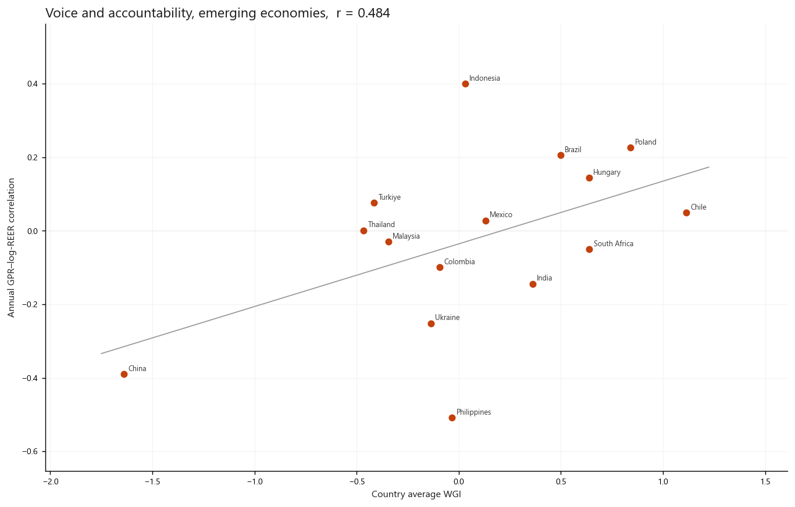
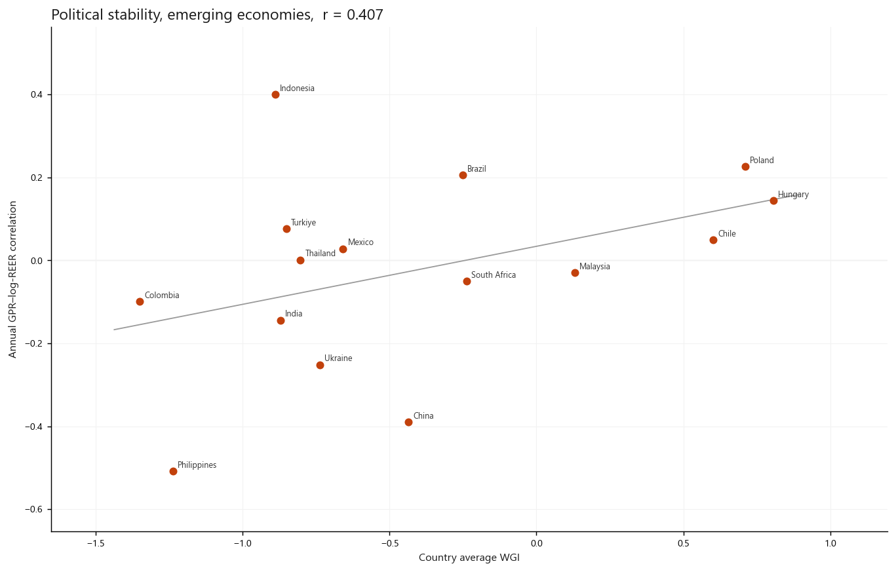
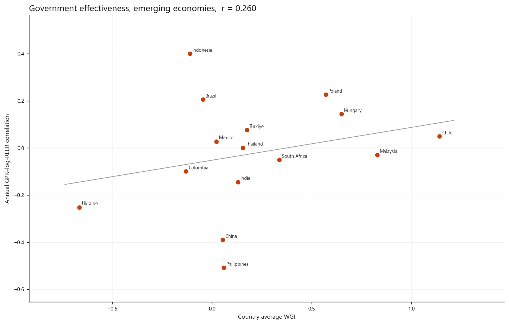
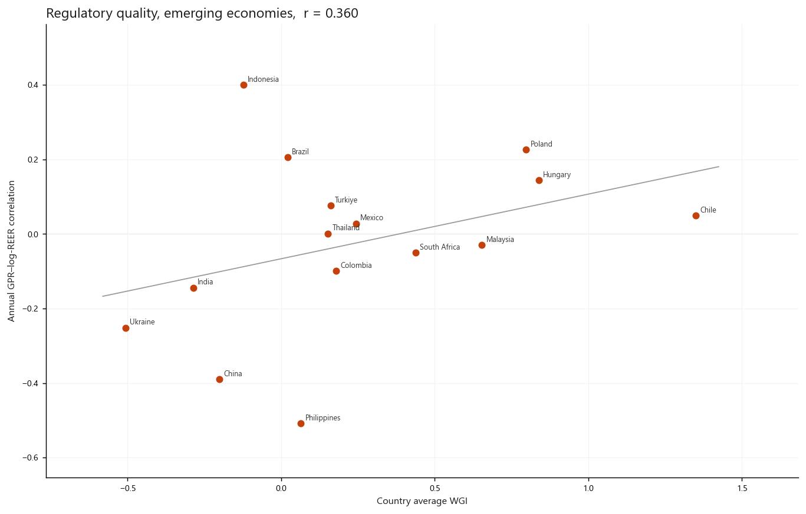
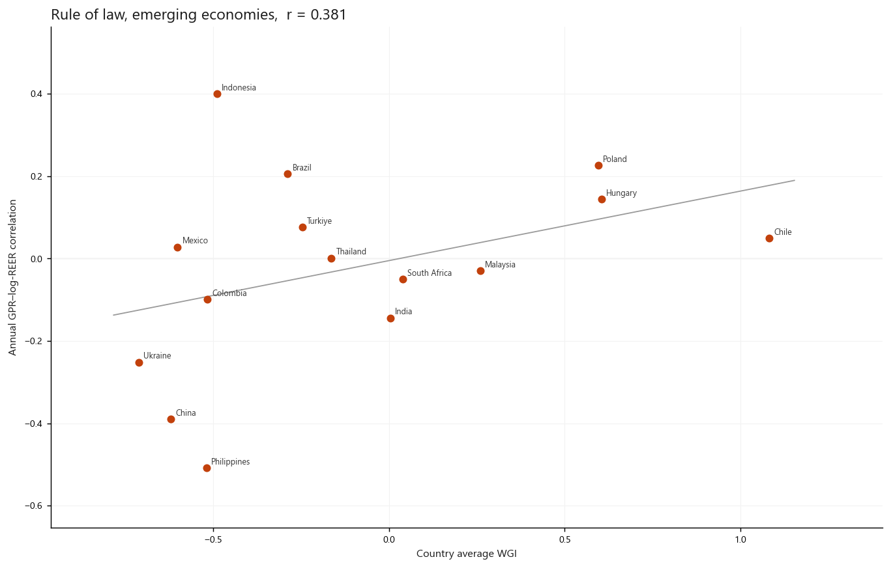
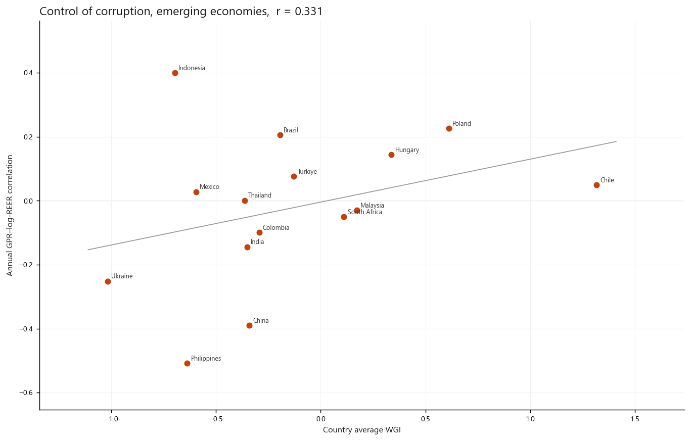

## `reer`

`reer` in `cleaned/replication_cleaned/country_month.csv` is the monthly broad real effective exchange rate, stored as an index with 2020 = 100. It is the level of the currency’s trade-weighted real value.

A real effective exchange rate averages a country’s bilateral exchange rates against its trading partners, then adjusts those rates for relative consumer prices. The series is the BIS broad basket (the raw BIS title is “Real — Broad (64 economies)”). A higher index means a real appreciation: the country’s goods are more expensive relative to its trading partners. A lower index means a real depreciation. Belgium in January 2000 is `93.22`, about 6.8% below Belgium’s own 2020 average.

The codebook entry is: BIS `WS_EER`, real, broad basket; IMF IFS `EREER_IX`, rebased to 2020, where BIS is missing. In this file that split is:

| Source | Country-months | Who |
| --- | --- | --- |
| BIS | 8,064 | Every country except Ukraine |
| IMF IFS | 288 | Ukraine, every month |

Each country uses one source for the whole sample. The level is filled for all 8,352 country-months (29 countries, January 2000–December 2023). Each country’s twelve months in 2020 average 100, so the index compares a country with its own 2020 average.

The stored monthly change is the separate column `d_log_reer`: the natural log this month minus the natural log last month. That is blank in January 2000 because the file has no December 1999. For Belgium, February 2000 is \(\ln(92.63)-\ln(93.22)=-0.00635\), a real depreciation of about 0.63% from January.

## Specification

One regression for each World Governance Indicators (WGI) dimension. Country fixed effects. Standard errors clustered by country. \(i\) is the country and \(t\) is the regression row. A row is a month, a quarter, or a year, as named in each section below. Parentheses in those tables are country-clustered standard errors. \(p<0.01\), \(p<0.05\), \(p<0.10\).

\[
\Delta \log REER_{i\tau}
= \alpha_i
+ \beta_1 GPR^{z}_{it}
+ \beta_2 WGI_{is}
+ \beta_3 \bigl(WGI_{is} \times GPR^{z}_{it}\bigr)
+ \boldsymbol{\gamma}^{\mathsf T}\mathbf{X}_{is}
+ \varepsilon_{it}
\]

\(\alpha_i\) is a country fixed effect. \(GPR^{z}\) is the within-country standardized GPR score stored as `gpr_z`. \(WGI\) is one governance score in its original units: voice and accountability, political stability, government effectiveness, regulatory quality, rule of law, or control of corruption. The interaction is that score times \(GPR^{z}\), and the product stays in those units. The GPR coefficient is the association at a WGI score of zero. \(\mathbf{X}\) is the control vector. \(\tau\) is the outcome period and \(s\) is the period of \(WGI\) and of \(\mathbf{X}\).

In the monthly regression, \(\tau=t\) and \(s=t-1\). In the next-quarter regression, \(\tau=t+1\) and \(s=t-1\). In the annual regression, \(\tau=t\) and \(s=t\): GPR, WGI, the interaction, and log VIX are year-\(t\) values, and the outcome and the other controls are changes from year \(t-1\).

The monthly and annual regressions read `cleaned/replication_cleaned/country_month.csv`. The next-quarter regression reads `cleaned/data_for_quarter_model.csv`. A blank required value leaves that row out.

| Role | Monthly | Next-quarter outcome | Annual |
| --- | --- | --- | --- |
| Outcome, change in log REER | `d_log_reer` in month \(t\) | Following quarter's `d_log_reer`, the sum of its three monthly log changes | Mean of the twelve monthly \(\ln(\text{reer})\) values in year \(t\), minus the previous year's mean |
| GPR, standardized | Stored `gpr_z` in month \(t\) | Mean of the three monthly `gpr_z` values in quarter \(t\) | Mean of the twelve monthly `gpr_z` values in year \(t\) |
| WGI | One of `wgi_va`, `wgi_pv`, `wgi_ge`, `wgi_rq`, `wgi_rl`, `wgi_cc`, lagged one month | The matching `wgi_*_lag1q` in quarter \(t-1\) | That year's score, repeated on every month |
| WGI × GPR | Lagged WGI times month-\(t\) `gpr_z` | Quarter-\(t-1\) WGI times quarter-\(t\) `gpr_z` | Same-year WGI times the same-year mean of `gpr_z` |
| Policy rate | `d_policy_rate`, lagged one month | `d_policy_rate_lag1q`, the sum of the three monthly changes in quarter \(t-1\) | First difference of the twelve-month mean of `policy_rate` |
| Inflation | `d_inflation`, lagged one month | `d_inflation_lag1q`, the sum of the three monthly changes in quarter \(t-1\) | First difference of the twelve-month mean of `inflation` |
| Log oil price | `d_log_oil`, lagged one month | `d_log_oil_lag1q`, the sum of the three monthly log changes in quarter \(t-1\) | First difference of the twelve-month mean of the monthly log of `oil_price` |
| Log VIX | Natural log of `vix`, lagged one month | `ln_vix_lag1q`, the mean of the three monthly logs in quarter \(t-1\) | Mean of the twelve monthly logs of `vix` in year \(t\) |
| Log global EPU | `d_log_gepu`, lagged one month | `d_log_gepu_lag1q`, the sum of the three monthly log changes in quarter \(t-1\) | First difference of the twelve-month mean of the monthly log of `gepu` |
| Financial development | `d_financial_development`, lagged one month | `d_financial_development_lag1q`, the annual change repeated on quarter \(t-1\) | This year's `financial_development` level minus last year's level |
| Debt/GDP | `d_public_debt_gdp`, lagged one month | `d_public_debt_gdp_lag1q`, the annual change repeated on quarter \(t-1\) | This year's `public_debt_gdp` level minus last year's level |

WGI, the financial-development change, and the debt/GDP change are annual values repeated on every month of the calendar year. Their one-month lag is the current year's value from February through December, and the previous year's value in January.

## Monthly baseline

The monthly column of the specification above. The outcome is `d_log_reer`. This is the baseline from the Model 1 design slide in `final_master_presentation.html`.

### Emerging economies

The sample is the Emerging group in `cleaned/replication_cleaned/country_month.csv`. The regression is `output/run_model1_monthly_emerging.py`. Results are `output/model1_monthly_emerging_results.csv`.

3,315 country-months, 14 countries, February 2002–January 2022. Twelve countries contribute all 240 months. Türkiye contributes 238 months, from April 2002. Indonesia contributes 197 months, from September 2005 through January 2022. Those shorter spans are months in which the lagged policy-rate change is blank. Ukraine has no policy rate in the file, so it contributes no months.

Countries: Brazil, Chile, China, Colombia, Hungary, India, Indonesia, Malaysia, Mexico, Philippines, Poland, South Africa, Thailand, and Türkiye.

Parentheses are country-clustered standard errors. \(p<0.01\), \(p<0.05\), \(p<0.10\). Standardized GPR has \(p>0.10\) in every column. The voice-and-accountability interaction is the WGI × GPR coefficient with \(p<0.10\). Lagged government effectiveness and lagged regulatory quality are the governance coefficients with \(p<0.10\). The lagged policy-rate change, the lagged log oil-price change, and the lagged debt/GDP change clear that threshold in every column.

|  | Voice and accountability | Political stability | Government effectiveness | Regulatory quality | Rule of law | Control of corruption |
| --- | ---: | ---: | ---: | ---: | ---: | ---: |
| WGI, lagged | 0.001961 (0.002547) | 0.000186 (0.001560) | 0.003344** (0.001443) | 0.004071* (0.002073) | 0.001419 (0.003132) | 0.000415 (0.002086) |
| GPR, standardized | −0.000112 (0.000213) | −0.000348 (0.000280) | −0.000088 (0.000293) | −0.000160 (0.000414) | −0.000186 (0.000258) | −0.000202 (0.000233) |
| WGI × GPR | −0.000640* (0.000309) | −0.000360 (0.000395) | −0.000226 (0.000520) | −0.000046 (0.000597) | −0.000322 (0.000372) | −0.000358 (0.000440) |
| Policy rate, lagged change | 0.001446*** (0.000420) | 0.001404*** (0.000419) | 0.001355*** (0.000423) | 0.001381*** (0.000414) | 0.001416*** (0.000413) | 0.001397*** (0.000415) |
| Inflation, lagged change | 0.001844 (0.001296) | 0.001815 (0.001278) | 0.001796 (0.001248) | 0.001820 (0.001256) | 0.001826 (0.001297) | 0.001805 (0.001259) |
| Log oil price, lagged change | 0.017572** (0.007385) | 0.017597** (0.007359) | 0.018086** (0.007187) | 0.017591** (0.007249) | 0.017559** (0.007385) | 0.017619** (0.007351) |
| Log VIX, lagged | 0.002910 (0.001778) | 0.002919 (0.001780) | 0.003154 (0.001812) | 0.002887 (0.001736) | 0.002912 (0.001774) | 0.002915 (0.001807) |
| Log global EPU, lagged change | 0.002962 (0.001864) | 0.002947 (0.001885) | 0.002883 (0.001882) | 0.002954 (0.001869) | 0.002927 (0.001886) | 0.002935 (0.001896) |
| Financial development, lagged change | 0.039451 (0.025691) | 0.040595 (0.026788) | 0.043340 (0.026483) | 0.038627 (0.026030) | 0.040142 (0.026143) | 0.040805 (0.026975) |
| Debt/GDP, lagged change | −0.000767*** (0.000129) | −0.000779*** (0.000140) | −0.000811*** (0.000144) | −0.000766*** (0.000136) | −0.000766*** (0.000133) | −0.000775*** (0.000139) |
| Observations | 3,315 | 3,315 | 3,315 | 3,315 | 3,315 | 3,315 |
| Countries | 14 | 14 | 14 | 14 | 14 | 14 |
| Within \(R^2\) | 0.0285 | 0.0280 | 0.0288 | 0.0288 | 0.0280 | 0.0280 |
| \(R^2\) | 0.0305 | 0.0300 | 0.0308 | 0.0308 | 0.0300 | 0.0299 |

## Next-quarter outcome, emerging economies

The next-quarter column of the specification above. Rows run from 2002-Q2 through 2022-Q1, so the last outcome quarter is 2022Q2. Results are `output/model1_quarterly_results.csv`.

1,104 country-quarters, 14 emerging economies. Parentheses are country-clustered standard errors. \(p<0.01\), \(p<0.05\), \(p<0.10\).

|  | Voice and accountability | Political stability | Government effectiveness | Regulatory quality | Rule of law | Control of corruption |
| --- | ---: | ---: | ---: | ---: | ---: | ---: |
| WGI, lagged | 0.004255 (0.006305) | 0.000502 (0.005466) | −0.000133 (0.006471) | 0.006670 (0.005887) | 0.003794 (0.008297) | 0.001338 (0.005077) |
| GPR, standardized | −0.002187 (0.002234) | −0.002110 (0.001859) | −0.001984 (0.003087) | −0.002203 (0.002806) | −0.002286 (0.002110) | −0.002316 (0.002141) |
| WGI x GPR | −0.000436 (0.002690) | 0.000767 (0.002995) | −0.001024 (0.004213) | −0.000228 (0.003095) | −0.001588 (0.003361) | −0.000800 (0.002764) |
| Policy rate, lagged change | 0.004241** (0.001734) | 0.004171** (0.001760) | 0.004176** (0.001805) | 0.004149** (0.001782) | 0.004216** (0.001718) | 0.004182** (0.001774) |
| Inflation, lagged change | −0.001361* (0.000674) | −0.001398* (0.000678) | −0.001387* (0.000683) | −0.001368* (0.000683) | −0.001357* (0.000669) | −0.001388* (0.000688) |
| Log oil price, lagged change | −0.005897 (0.005746) | −0.005723 (0.005745) | −0.005778 (0.006243) | −0.005787 (0.005924) | −0.005867 (0.005699) | −0.005776 (0.005831) |
| Log VIX, lagged | 0.012200* (0.005964) | 0.012334* (0.005881) | 0.012342** (0.005680) | 0.012334** (0.005681) | 0.012443* (0.005892) | 0.012380* (0.005856) |
| Log global EPU, lagged change | 0.016520*** (0.003460) | 0.016517*** (0.003526) | 0.016519*** (0.003521) | 0.016575*** (0.003493) | 0.016427*** (0.003471) | 0.016486*** (0.003489) |
| Financial development, lagged change | 0.103220 (0.064522) | 0.107563 (0.063433) | 0.107033 (0.061813) | 0.103697 (0.063819) | 0.105702 (0.064642) | 0.106899 (0.064036) |
| Debt/GDP, lagged change | −0.001221*** (0.000336) | −0.001240*** (0.000313) | −0.001260*** (0.000310) | −0.001242*** (0.000333) | −0.001240*** (0.000315) | −0.001257*** (0.000323) |
| Observations | 1,104 | 1,104 | 1,104 | 1,104 | 1,104 | 1,104 |
| Countries | 14 | 14 | 14 | 14 | 14 | 14 |
| Quarters | 2002-Q2 to 2022-Q1 | 2002-Q2 to 2022-Q1 | 2002-Q2 to 2022-Q1 | 2002-Q2 to 2022-Q1 | 2002-Q2 to 2022-Q1 | 2002-Q2 to 2022-Q1 |
| Within \(R^2\) | 0.0351 | 0.0348 | 0.0347 | 0.0353 | 0.0350 | 0.0347 |
| \(R^2\) | 0.0382 | 0.0379 | 0.0379 | 0.0384 | 0.0382 | 0.0379 |

## Annual estimates, emerging economies

The annual column of the specification above. Results are `output/model1_annual_emerging_mean_diff_results.csv`.

273 country-years, 14 emerging economies, 2002–2021. Indonesia contributes 2007–2021 and Turkiye contributes 2004–2021. Ukraine contributes no years. Parentheses are country-clustered standard errors. \(p<0.01\), \(p<0.05\), \(p<0.10\).

|  | Voice and accountability | Political stability | Government effectiveness | Regulatory quality | Rule of law | Control of corruption |
| --- | ---: | ---: | ---: | ---: | ---: | ---: |
| WGI | 0.028816 (0.018889) | 0.005083 (0.013886) | 0.020594 (0.013411) | 0.040749* (0.019382) | 0.029233 (0.022479) | 0.031395* (0.017337) |
| GPR, standardized | −0.014448** (0.006108) | −0.015417** (0.006285) | −0.015169** (0.005194) | −0.015632** (0.005447) | −0.014760** (0.005135) | −0.016072*** (0.004732) |
| WGI × GPR | 0.004611 (0.005699) | 0.000715 (0.006387) | −0.002368 (0.007443) | −0.002189 (0.005651) | 0.003578 (0.007775) | 0.006505 (0.006265) |
| Policy rate, annual change | 0.003099 (0.002792) | 0.002805 (0.002931) | 0.002583 (0.002974) | 0.002334 (0.002812) | 0.003026 (0.002718) | 0.002755 (0.002820) |
| Inflation, annual change | −0.010637** (0.003671) | −0.010939** (0.003697) | −0.010955** (0.003655) | −0.010717** (0.003649) | −0.010812** (0.003743) | −0.010946** (0.003685) |
| Log oil price, annual change | 0.072929*** (0.020902) | 0.073958*** (0.021034) | 0.076385*** (0.020178) | 0.073049*** (0.021448) | 0.072820*** (0.021816) | 0.073807*** (0.021376) |
| Log VIX | −0.021193** (0.008441) | −0.018459** (0.008042) | −0.015582* (0.008313) | −0.018941** (0.007474) | −0.018853** (0.007540) | −0.019438** (0.007515) |
| Log global EPU, annual change | 0.053405*** (0.012444) | 0.054584*** (0.013024) | 0.051887*** (0.013073) | 0.053738*** (0.012244) | 0.053982*** (0.011902) | 0.054188*** (0.012367) |
| Financial development, annual change | −0.040139 (0.228658) | −0.002835 (0.236941) | 0.015873 (0.242448) | −0.027066 (0.232313) | −0.020631 (0.237631) | −0.006944 (0.244660) |
| Debt/GDP, annual change | −0.003143*** (0.000905) | −0.003513*** (0.001086) | −0.003685*** (0.001074) | −0.003485*** (0.001051) | −0.003278*** (0.001058) | −0.003443*** (0.001027) |
| Observations | 273 | 273 | 273 | 273 | 273 | 273 |
| Countries | 14 | 14 | 14 | 14 | 14 | 14 |
| Years | 2002 to 2021 | 2002 to 2021 | 2002 to 2021 | 2002 to 2021 | 2002 to 2021 | 2002 to 2021 |
| Within \(R^2\) | 0.2660 | 0.2581 | 0.2615 | 0.2693 | 0.2631 | 0.2647 |
| \(R^2\) | 0.2872 | 0.2795 | 0.2828 | 0.2904 | 0.2844 | 0.2860 |

## Debt/GDP, annual change

This year's `public_debt_gdp` level minus last year's level. In the control-outcome regressions, this series is the outcome and is omitted from the regressors. The emerging country-years, country fixed effects, and country-clustered standard errors match the annual REER regression above. GPR, WGI, and the interaction stay in the same year. The change in mean log REER is not a regressor. Results are `output/model1_annual_emerging_control_outcomes.csv`.

|  | Voice and accountability | Political stability | Government effectiveness | Regulatory quality | Rule of law | Control of corruption |
| --- | ---: | ---: | ---: | ---: | ---: | ---: |
| WGI | −2.910935* (1.586543) | 0.035916 (1.484307) | 1.878921 (1.245239) | −1.062460 (2.174671) | −3.140353 (2.204953) | −0.801847 (1.991271) |
| GPR, standardized | −0.624035 (0.607020) | −1.497756* (0.709597) | 0.260538 (0.678467) | 0.303285 (0.713253) | −0.834130 (0.625902) | −0.588952 (0.593257) |
| WGI x GPR | −2.058312*** (0.520711) | −1.756118** (0.656457) | −2.821481** (1.005788) | −2.429884* (1.147022) | −2.342931* (1.311225) | −1.806300 (1.097640) |
| Policy rate, annual change | −0.095849 (0.162676) | −0.059924 (0.173200) | −0.084526 (0.183764) | −0.067478 (0.187041) | −0.094278 (0.161095) | −0.069308 (0.190007) |
| Inflation, annual change | −0.024880 (0.116855) | 0.004734 (0.109008) | 0.016587 (0.109536) | 0.011228 (0.112542) | 0.006293 (0.104314) | 0.011786 (0.112731) |
| Log oil price, annual change | −4.541756*** (0.919746) | −4.928350*** (0.873920) | −4.641457*** (0.930729) | −4.982589*** (0.927218) | −4.726294*** (0.945088) | −4.958683*** (0.904190) |
| Log VIX | 3.901915*** (1.119567) | 3.379419** (1.142695) | 3.393721*** (1.006046) | 3.409246*** (1.046641) | 3.575198*** (1.115119) | 3.505880*** (1.098681) |
| Log global EPU, annual change | 0.079352 (1.179793) | 0.000672 (1.208056) | 0.045192 (1.222780) | −0.004458 (1.166608) | −0.112878 (1.240982) | 0.043333 (1.152230) |
| Financial development, annual change | 10.157086 (12.218032) | 3.772513 (12.281885) | 6.090857 (12.460434) | 5.761382 (11.674087) | 7.473452 (12.915348) | 4.800914 (12.540989) |
| Observations | 273 | 273 | 273 | 273 | 273 | 273 |
| Countries | 14 | 14 | 14 | 14 | 14 | 14 |
| Years | 2002 to 2021 | 2002 to 2021 | 2002 to 2021 | 2002 to 2021 | 2002 to 2021 | 2002 to 2021 |
| Within \(R^2\) | 0.3205 | 0.2937 | 0.2972 | 0.2889 | 0.3056 | 0.2788 |
| \(R^2\) | 0.3532 | 0.3277 | 0.3310 | 0.3231 | 0.3391 | 0.3135 |

## Annual GPR–REER correlation and average WGI, emerging economies

Each point is one emerging economy. The vertical axis is that country's annual correlation between standardized GPR and the change in log REER. The horizontal axis is that country's average WGI score. The line is the cross-country fit. The figure in the title is the Pearson correlation across the 15 emerging economies. Charts are from [correlation_annual_gpr_reer_and_wgi_emerging.html](../../output/correlation_annual_gpr_reer_and_wgi_emerging.html).

Voice and accountability, \(r = 0.484\).

Political stability, \(r = 0.407\).

Government effectiveness, \(r = 0.260\).

Regulatory quality, \(r = 0.360\).

Rule of law, \(r = 0.381\).

Control of corruption, \(r = 0.331\).

