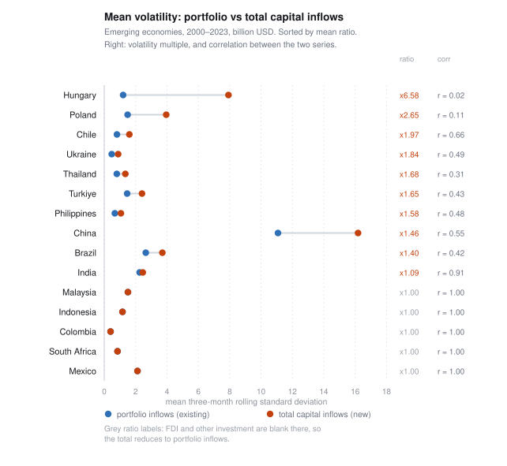

# Model 2

Baseline capital-flow-volatility regression for the emerging-market subsample, from the Model 2 design slide in `master_presentation.html`. The outcome is capital-flow volatility. The WGI terms, the interaction, the control set, the estimator, and the clustered standard errors match Model 1 in `model1.md`; the sample differs in two ways — the outcome is volatility rather than the log-REER change, and the panel is restricted to emerging economies.

One regression for each World Governance Indicators (WGI) dimension. Country fixed effects. Standard errors clustered by country.

The specification is estimated four times, on three panels and with one change of outcome definition. All four share the same equation, control set, estimator, country fixed effects, and country clustering; only the frequency, the source of the outcome, or the definition of the flow changes. In order of appearance in this note:

- **Monthly**, on `cleaned/replication_cleaned/country_month.csv`, giving 2,567 country-months. This is the baseline and the version documented first.
- **Quarterly**, on `cleaned/data_for_quarter_model.csv`, giving 859 country-quarters, under [Quarterly estimates](#quarterly-estimates).
- **Monthly with total capital inflows** as the outcome instead of portfolio inflows, still 2,567 country-months, under [Capital-inflow volatility as the outcome](#capital-inflow-volatility-as-the-outcome). This is the one run that changes the outcome definition rather than the frequency.
- **Annual**, on `cleaned/replication_cleaned/country_year.csv` built from the monthly file, giving 204 country-years, under [Annual estimates](#annual-estimates).

The monthly and quarterly columns are comparable side by side because both preserve the paper's outcome definition. The capital-inflow run is a robustness check on that definition, and the annual run is a robustness check on the frequency. Coefficients are not comparable in magnitude across any of them.

## Equation

The equation below holds for all four runs; what changes is the frequency of \(t\), the source of the outcome, or the definition of the flow. In the monthly panel \(t\) is a month and \(CFV_{it}\) is the three-month rolling standard deviation of monthly portfolio inflows. In the quarterly panel \(t\) is a quarter and \(CFV_{it}\) is the mean of the three monthly standard deviations inside that quarter. The capital-inflow run keeps the monthly clock but replaces portfolio inflows with portfolio plus FDI plus other investment. The annual run sets \(t\) to a year and averages the twelve monthly values. Sections up to [Comparison with the pooled panel](#comparison-with-the-pooled-panel) describe the monthly estimates with the paper's outcome definition.

\[
CFV_{it}
= \alpha_i
+ \beta_1 GPR^{z}_{it}
+ \beta_2 WGI_{i,t-1}
+ \beta_3 \bigl(WGI_{i,t-1} \times GPR^{z}_{it}\bigr)
+ \boldsymbol{\gamma}^{\mathsf T}\mathbf{X}_{i,t-1}
+ \varepsilon_{it}
\]

\(i\) is the country and \(t\) is the month. \(\alpha_i\) is a country fixed effect. \(CFV_{it}\) is capital-flow volatility, the three-month rolling standard deviation of monthly portfolio inflows, in billions of US dollars. It enters in levels, not logs, because the series contains exact zeros and because the paper keeps the same units.

\(WGI\) is one governance score. The six scores are estimated in separate regressions: voice and accountability, political stability, government effectiveness, regulatory quality, rule of law, and control of corruption.

\(GPR^{z}\) is the stored column `gpr_z`. It equals the country GPR score minus that country's mean, divided by that country's sample standard deviation. The mean and the standard deviation use every month in the file from January 2000 through December 2023. The divisor is the number of those months minus one. The regression uses the stored column in the current month.

The lagged WGI score stays in its original units. The interaction is that lagged score times current-month `gpr_z`. The product is not standardized, and the lagged score is not centered. The GPR coefficient is the association at a lagged WGI score of zero, which for the six WGI scores is far outside the observed range; it is not an effect "at the average" score.

\(\mathbf{X}_{i,t-1}\) is the lagged control vector below. A lag is the previous calendar month for the same country. If that month's value is blank, the current month is left out of the regression.

The control set is the differenced set used in Model 1. Financial development and debt/GDP are differenced annually in the storing step, so their one-month lag carries the current year's change from February through December and the previous year's change in January.

## Variables

| Role | Column | How it enters |
| --- | --- | --- |
| Outcome: capital-flow volatility | `capital_flow_volatility` | Three-month rolling SD of portfolio inflows, billions of USD, current month, level |
| Sample flag | `group` | Keeps rows where `group` is `Emerging` |
| WGI | `wgi_va`, `wgi_pv`, `wgi_ge`, `wgi_rq`, `wgi_rl`, `wgi_cc` | Lagged one month. One column per regression |
| Treated financial development | `d_financial_development` | Annual change, lagged one month |
| Treated debt/GDP | `d_public_debt_gdp` | Annual change, lagged one month |
| Treated policy rate | `d_policy_rate` | Monthly change, lagged one month |
| Treated inflation | `d_inflation` | Monthly change, lagged one month |
| Treated log oil price | `d_log_oil` | Monthly change in log WTI, lagged one month |
| Treated log global EPU | `d_log_gepu` | Monthly change in log global EPU, lagged one month |
| WGI × GPR | lagged `wgi_*` × `gpr_z` | Lagged WGI in its original units, times `gpr_z`. The product is not standardized |
| Standardized GPR | `gpr_z` | Stored column, current month |
| Log VIX | `vix` | Natural log of the level, lagged one month |

`vix` enters only when it is positive. In this file it is positive in every month.

## Sample

Emerging economies only. The panel's `group` column labels each country-month either `Emerging` or `Advanced`; this regression keeps the `Emerging` rows and drops the 14 advanced economies.

A country-month is used when it sits in the window, carries the `Emerging` label, and has a non-missing outcome and a non-missing value for every entered regressor. All six regressions use the same 2,567 country-months across 14 countries.

The window is February 2002 through January 2022, the same window as Model 1. Within it, 3,600 country-months carry the `Emerging` label. Two constraints then bind:

- The outcome must be non-missing. Capital-flow volatility needs the current month and two prior months of portfolio inflows, and portfolio inflows are blank in many emerging country-months. This leaves 2,712.
- The lagged policy-rate change must be non-missing. This drops a further 145 country-months, leaving 2,567. No other control removes any observation.

The 14 countries in the regression, with their counts out of 240 possible months: Brazil 240, India 240, South Africa 240, Türkiye 238, Chile 227, Poland 215, the Philippines 203, Thailand 203, Hungary 167, Mexico 155, Indonesia 131, Malaysia 130, China 95, and Colombia 83. Only Brazil, India, and South Africa cover the full window. The shorter spans follow portfolio-inflow coverage, not WGI coverage.

Ukraine is labelled `Emerging` in the panel but contributes no observations. It has no policy rate in the file, so the lagged policy-rate change is always blank.

The 14 advanced economies in the panel are excluded: Belgium, Canada, Denmark, Finland, France, Germany, Italy, Japan, Korea, the Netherlands, Portugal, Spain, Sweden, and the United States. Korea and Türkiye are the names stored in the file.

## Estimator

Ordinary least squares with a full set of country indicators. The reported slopes are the within-country associations.

Standard errors are clustered by country. For each country, form the score from that country's residuals and regressors, and add the outer product of the score to the meat of the sandwich. Multiply the sandwich by

\[
\frac{G}{G-1}\times\frac{N-1}{N-k}
\]

where \(G\) is the number of countries, \(N\) is the number of country-months, and \(k\) is the number of estimated coefficients, including the intercept and the country indicators. \(p\)-values use a two-sided \(t\) distribution with \(G-1\) degrees of freedom. With 14 countries that is 13 degrees of freedom, so the critical values are wider than in the 28-country pooled model. \*\*\* \(p<0.01\), \*\* \(p<0.05\), \* \(p<0.10\).

The regression is `output/run_model2.py`. It writes `output/model2_results.csv`. The estimator core is imported from `output/run_export_reer_2sls.py`, the same code path Model 1 uses, so the two models share one implementation of the fixed effects and the cluster correction.

## Estimates

2,567 country-months, 14 countries, February 2002–January 2022. Parentheses are country-clustered standard errors. Within \(R^2\) is the fit after removing country means of the outcome. The \(R^2\) column includes those country means.

A rendering with shaded significance cells and exact \(p\)-values for every coefficient is in [`output/model2_results.html`](../output/model2_results.html). It is regenerated together with the CSV by `output/run_model2.py`.

None of the three terms of interest is significant at 10 percent in any column. Standardized GPR runs from 0.0045 to 0.0819 with \(p\) between 0.34 and 0.97. WGI × GPR runs from −0.2686 to 0.1162 with \(p\) between 0.28 and 0.83. The lagged WGI score clears 10 percent in exactly one column, government effectiveness (1.2381, \(p=0.057\)); every other column is above \(p=0.17\).

Among the controls, the lagged log oil-price change clears 10 percent in all six columns (between −1.27 and −1.37). The lagged debt/GDP change clears it in one column, control of corruption (0.0378, \(p=0.09\)), and the lagged financial-development change in one, voice and accountability (−7.3235, \(p=0.078\)). The lagged policy rate, inflation, log VIX, and log global EPU never clear it.

|  | Voice and accountability | Political stability | Government effectiveness | Regulatory quality | Rule of law | Control of corruption |
| --- | ---: | ---: | ---: | ---: | ---: | ---: |
| WGI, lagged | −0.6529 (0.4567) | −0.2734 (0.5352) | 1.2381* (0.5921) | −0.1969 (0.5819) | 0.0097 (0.3403) | 0.2152 (0.8864) |
| GPR, standardized | 0.0686 (0.0955) | 0.0713 (0.0716) | 0.0045 (0.0990) | 0.0819 (0.1445) | 0.0522 (0.0842) | 0.0521 (0.0805) |
| WGI × GPR | −0.2686 (0.2360) | 0.0653 (0.0639) | 0.1162 (0.1334) | −0.0750 (0.1607) | −0.1265 (0.1482) | 0.0186 (0.0853) |
| Policy rate, lagged change | 0.0383 (0.0597) | 0.0467 (0.0719) | 0.0384 (0.0665) | 0.0512 (0.0652) | 0.0499 (0.0658) | 0.0503 (0.0638) |
| Inflation, lagged change | −0.0248 (0.0451) | −0.0288 (0.0403) | −0.0338 (0.0445) | −0.0214 (0.0435) | −0.0187 (0.0405) | −0.0244 (0.0453) |
| Log oil price, lagged change | −1.3140** (0.6000) | −1.3586** (0.5998) | −1.2730* (0.6198) | −1.3501** (0.6005) | −1.3513** (0.6106) | −1.3737** (0.6123) |
| Log VIX, lagged | 0.5159 (0.4819) | 0.4464 (0.4075) | 0.4621 (0.4502) | 0.4386 (0.4150) | 0.4374 (0.4288) | 0.4114 (0.3815) |
| Log global EPU, lagged change | −0.0297 (0.1998) | −0.0351 (0.1948) | −0.0215 (0.2037) | −0.0272 (0.1918) | −0.0239 (0.1989) | −0.0249 (0.1929) |
| Financial development, lagged change | −7.3235* (3.8531) | −8.4250 (5.0974) | −7.7075 (4.8271) | −8.4256 (4.9324) | −8.3786 (4.8573) | −8.4209 (4.7709) |
| Debt/GDP, lagged change | 0.0260 (0.0305) | 0.0361 (0.0217) | 0.0308 (0.0274) | 0.0352 (0.0221) | 0.0361 (0.0237) | 0.0378* (0.0213) |
| Observations | 2,567 | 2,567 | 2,567 | 2,567 | 2,567 | 2,567 |
| Countries | 14 | 14 | 14 | 14 | 14 | 14 |
| Within \(R^2\) | 0.0384 | 0.0305 | 0.0393 | 0.0298 | 0.0302 | 0.0296 |
| \(R^2\) | 0.4146 | 0.4098 | 0.4151 | 0.4094 | 0.4096 | 0.4092 |

### Correlations

A correlation matrix for the same monthly estimation sample is in [`output/model2_correlation.html`](../output/model2_correlation.html), with the numbers in [`output/model2_correlations.csv`](../output/model2_correlations.csv). It is produced by `output/plot_model2_correlations.py`. The matrix covers the outcome, `gpr_z`, the six lagged WGI scores, and the seven lagged controls, on the exact 2,567 country-months the regression uses, so every cell comes from the same rows.

These are raw Pearson correlations, not partial effects. A pair can be strongly correlated while its regression coefficient is insignificant, because the fixed effects and the other controls absorb much of the variation.

The strongest associations with the outcome are institutional and negative. Voice and accountability −0.31 is the largest, then regulatory quality −0.23 and rule of law −0.18. Control of corruption −0.08, political stability −0.03, and government effectiveness −0.02 are weaker but still negative. All six WGI scores therefore line up the same way: countries with weaker governance scores have more volatile capital flows in this sample. GPR itself correlates with the outcome at only +0.08.

The six WGI scores are positively correlated with each other in every pair, from +0.31 between voice and accountability and government effectiveness up to +0.91 between rule of law and control of corruption. That is why the scores are estimated one at a time rather than together: in a single regression they would be close to collinear. GPR is nearly uncorrelated with every WGI score, between −0.10 and +0.03, which is what makes the interaction term estimable at all.

Among the controls, only two stand out against the outcome: the lagged debt/GDP change at +0.15 and the lagged log oil-price change at −0.08. The rest sit between −0.03 and +0.07. That the oil change is significant in all six regressions despite a correlation of −0.08 is a reminder that the raw correlation and the within-country coefficient answer different questions.

### Reading the magnitudes

The outcome is in billions of dollars, so a coefficient is a change in that unit. A one-standard-deviation rise in `gpr_z` with the interaction at zero moves volatility by the GPR coefficient: between 0.0045 and 0.0819 billion dollars, roughly 5 to 82 million dollars. All six of those estimates are small relative to their standard errors.

The interaction is the change in that GPR slope per one point of the lagged WGI score. The largest point estimate is voice and accountability (−0.2686, standard error 0.2360). It is the only column where the sign is negative and the estimate exceeds one standard error in magnitude. All six interactions are statistically indistinguishable from zero at conventional levels.

### Comparison with the pooled panel

The same specification on all 28 countries gives 5,324 country-months and finds the interaction negative in all six columns, clearing 10 percent in two. Restricting to the 14 emerging economies cuts the sample to 2,567 and leaves both the GPR level and the interaction insignificant everywhere. Two differences are worth keeping in mind when reading the sides together:

- The clustered standard errors are computed over 14 countries instead of 28, which widens every interval through the \(G/(G-1)\) factor and the 13-degree-of-freedom \(t\) distribution.
- The emerging panel is much more unbalanced. Three of the 14 countries cover the full window, and China and Colombia contribute 95 and 83 months.

So the loss of significance in the subsample cannot be read as evidence that the relationship is absent in emerging economies specifically; the subsample has both fewer observations and fewer clusters.

## Quarterly estimates

The same specification run on quarterly data, from `cleaned/data_for_quarter_model.csv`. Nothing about the equation, the control set, the estimator, or the clustering changes; only the frequency of the panel and the construction of the outcome.

The regression is `output/run_model2_quarterly.py`. It writes `output/model2_quarterly_results.csv` and `output/model2_quarterly_results.html`; the HTML shades every coefficient by significance level and prints its exact \(p\)-value.

### How the quarterly file is built

Each row is one country-quarter, keyed by `iso` and `year_quarter`, over 96 quarters from 2000-Q1 to 2023-Q4. The file stores the quarterly outcome, the standardized GPR, and the lagged regressors already assembled, so the regression reads columns rather than rebuilding lags as the monthly script does.

| Role | Column | How it enters |
| --- | --- | --- |
| Outcome: capital-flow volatility | `capital_flow_volatility` | Mean of the three monthly three-month rolling SDs inside the quarter, billions of USD, level |
| Sample flag | `group` | Keeps rows where `group` is `Emerging` |
| WGI | `wgi_va_lag1q` … `wgi_cc_lag1q` | Lagged one quarter, original units. One column per regression |
| WGI × GPR | `wgi_*_lag1q_x_gpr_z` | Stored product of the lagged WGI score and `gpr_z` |
| Standardized GPR | `gpr_z` | Stored column, current quarter |
| Treated policy rate | `d_policy_rate_lag1q` | Quarterly change, lagged one quarter |
| Treated inflation | `d_inflation_lag1q` | Change, lagged one quarter |
| Treated log oil price | `d_log_oil_lag1q` | Change in log WTI, lagged one quarter |
| Treated log global EPU | `d_log_gepu_lag1q` | Change in log global EPU, lagged one quarter |
| Treated financial development | `d_financial_development_lag1q` | Change, lagged one quarter |
| Treated debt/GDP | `d_public_debt_gdp_lag1q` | Change, lagged one quarter |
| Log VIX | `ln_vix_lag1q` | Log of the level, lagged one quarter |

Two properties of the file were checked directly rather than assumed. The quarterly outcome equals the arithmetic mean of the three monthly volatility figures in that quarter in all 2,163 non-missing cells of the full panel, and the stored interactions `wgi_*_lag1q_x_gpr_z` equal the lagged WGI score times `gpr_z` in all 15,834 non-missing cells. So the quarterly outcome is a within-quarter average of the monthly volatility measure, not a volatility of quarterly flows.

Because the outcome averages three months, its variance is smaller than the monthly series and the quarterly coefficients are not directly comparable in size to the monthly ones. A one-unit change in a regressor that persists across a quarter now moves an averaged outcome.

### Quarterly sample

Emerging economies only, the same `group` filter. A country-quarter is used when it carries the `Emerging` label and has a non-missing outcome, `gpr_z`, the lagged WGI score, the interaction, and every lagged control.

Of the 1,440 emerging country-quarters in the file, 1,049 have the outcome. Three constraints then reduce that to 859:

- Financial development removes 121. Its annual series ends in 2021, so `d_financial_development_lag1q` is blank after 2022-Q1 and the first usable quarter is 2001-Q2.
- The lagged policy-rate change removes 49. Ukraine has no policy rate at all, so it drops out entirely, as in the monthly run.
- The lagged WGI score removes 20. The file holds no WGI value for 2001, and 2002-Q1 has no usable lag as a result.

The effective window is therefore **2002-Q2 through 2022-Q1**, 80 quarters, with 14 countries. Ukraine is the only emerging country in the panel that contributes nothing — the same country excluded from the monthly run for the same reason. Per-country counts out of the 80 quarters: Brazil 80, India 80, South Africa 80, Türkiye 79, Chile 76, Poland 72, the Philippines 68, Thailand 68, Hungary 56, Mexico 52, Indonesia 44, Malaysia 44, China 32, and Colombia 28.

### Quarterly estimates

859 country-quarters, 14 countries, 2002-Q2 to 2022-Q1. Parentheses are country-clustered standard errors. Within \(R^2\) removes country means of the outcome; \(R^2\) includes them.

|  | Voice and accountability | Political stability | Government effectiveness | Regulatory quality | Rule of law | Control of corruption |
| --- | ---: | ---: | ---: | ---: | ---: | ---: |
| WGI, lagged | −0.5714 (0.5015) | −0.2127 (0.5530) | 1.2736** (0.5564) | −0.1361 (0.5750) | 0.2132 (0.4465) | 0.3335 (0.9207) |
| GPR, standardized | 0.1613 (0.1524) | 0.1888 (0.1899) | 0.0236 (0.1637) | 0.2810 (0.3216) | 0.1585 (0.1732) | 0.1698 (0.1921) |
| WGI × GPR | −0.7799 (0.4694) | 0.0918 (0.1475) | 0.3731 (0.3289) | −0.3489 (0.4524) | −0.4016 (0.4727) | 0.0740 (0.2326) |
| Policy rate, lagged change | 0.1024 (0.0724) | 0.0794 (0.0714) | 0.0760 (0.0673) | 0.0862 (0.0681) | 0.0890 (0.0707) | 0.0822 (0.0673) |
| Inflation, lagged change | −0.0504 (0.0622) | −0.0422 (0.0618) | −0.0479 (0.0649) | −0.0392 (0.0633) | −0.0379 (0.0617) | −0.0423 (0.0641) |
| Log oil price, lagged change | −0.6642** (0.2745) | −0.6370** (0.2436) | −0.5767** (0.2571) | −0.6251** (0.2384) | −0.6270** (0.2492) | −0.6496** (0.2504) |
| Log VIX, lagged | 0.2972 (0.5036) | 0.2086 (0.4259) | 0.2364 (0.4860) | 0.1873 (0.4249) | 0.2017 (0.4599) | 0.1623 (0.3919) |
| Log global EPU, lagged change | −0.0748 (0.2750) | −0.0199 (0.2417) | −0.0032 (0.2332) | −0.0375 (0.2491) | −0.0456 (0.2612) | −0.0185 (0.2355) |
| Financial development, lagged change | −5.3922** (1.9054) | −7.6191* (3.5976) | −6.7907* (3.3295) | −7.6031** (3.4236) | −7.4858** (3.1457) | −7.5176** (3.2103) |
| Debt/GDP, lagged change | 0.0261 (0.0262) | 0.0393** (0.0161) | 0.0345 (0.0218) | 0.0373* (0.0173) | 0.0399** (0.0185) | 0.0413** (0.0159) |
| Observations (country-quarters) | 859 | 859 | 859 | 859 | 859 | 859 |
| Countries | 14 | 14 | 14 | 14 | 14 | 14 |
| Within \(R^2\) | 0.0710 | 0.0329 | 0.0478 | 0.0349 | 0.0369 | 0.0325 |
| \(R^2\) | 0.5175 | 0.4977 | 0.5055 | 0.4988 | 0.4998 | 0.4975 |

### Reading the quarterly estimates

The pattern in the terms of interest matches the monthly run, and the coefficient of interest is still not significant.

- **GPR** is positive in all six columns, from 0.0236 to 0.2810, but never clears 10 percent; the smallest \(p\)-value is 0.309. The signs now all agree with the intuition that higher geopolitical risk raises capital-flow volatility, where the monthly run had one coefficient essentially at zero.
- **WGI × GPR** is insignificant in every column, with \(p\) between 0.121 and 0.756. Voice and accountability is the largest in magnitude (−0.7799, standard error 0.4694), the same column that carried the largest monthly interaction.
- **Lagged WGI** clears 10 percent in one column, government effectiveness (1.2736, \(p=0.039\)). This is the same single column that reached 10 percent in the monthly run at \(p=0.057\), so the finding survives the change of frequency and strengthens slightly.

Among the controls, the quarterly run is more informative than the monthly one. The lagged log oil-price change is negative and significant in all six columns (−0.5767 to −0.6642, \(p\) from 0.021 to 0.043). The lagged financial-development change is significant in all six (−5.3922 to −7.6191). The lagged debt/GDP change clears 10 percent in four columns, with \(p\) between 0.022 and 0.050. The lagged policy rate, inflation, log VIX, and log global EPU remain insignificant everywhere.

The overall fit is higher than in the monthly panel, with \(R^2\) near 0.50 and within \(R^2\) between 0.0325 and 0.0710. Part of that is mechanical: averaging three months removes within-quarter noise, so the country means explain more of the variance.

### Monthly and quarterly side by side

The two runs agree on the substantive answer and differ in how much precision the controls carry.

- The GPR level and the interaction are insignificant on both panels. Neither frequency produces evidence that institutional quality conditions the GPR effect on capital-flow volatility in emerging economies.
- Government effectiveness is the only WGI dimension that reaches 10 percent, and it does so on both panels. Every other dimension is insignificant on both.
- The controls are much better determined quarterly. Oil is significant in all six columns quarterly and in all six monthly; financial development and debt/GDP add several more significant columns quarterly.
- The quarterly sample is smaller (859 against 2,567 observations) but no less balanced per country: the smallest contributor has 28 quarters against Colombia's 83 months, and the median country has 68 quarters rather than 131 months.

The practical reading is that moving to quarterly data does not rescue the interaction. It does tighten the control coefficients and it keeps the government-effectiveness result, which is the one institutional finding robust to the change of frequency.

## Capital-inflow volatility as the outcome

A second monthly run replaces the outcome with volatility of **total capital inflows** rather than portfolio inflows alone. Every other element is inherited from the monthly specification above without change: the control set, the one-month lags, the country fixed effects, the country-clustered standard errors, the window, and the `Emerging` filter. The point is to ask whether widening the flow definition changes any conclusion, holding the design fixed.

### What the new outcome is

The existing `capital_flow_volatility` column is the three-month rolling standard deviation of `portfolio_inflow`, which is portfolio debt plus portfolio equity in billions of US dollars. The new outcome uses the same construction applied to a wider flow:

\[
\text{Inflow}_{it} = \text{port\_inf}_{it} + \text{fdi\_inf}_{it} + \text{other\_inf}_{it}
\]

\[
\text{InflowVol}_{it} = \mathrm{sd}\bigl(\text{Inflow}_{i,t-2},\ \text{Inflow}_{i,t-1},\ \text{Inflow}_{it}\bigr)
\]

The standard deviation uses the sample divisor, matching the existing column, and requires all three months to be observed. Both flow definitions are built from the same source sheet of `raw/oecd_capital_flows.xlsx`, so the difference between the two outcomes is exactly the FDI and other-investment components, nothing else.

The rebuilt series is stored in `cleaned/replication_cleaned/country_month_inflow.csv` with both flow measures and both volatility measures side by side, so the two can be compared country by country.

### Sample and comparability

Both outcomes are non-missing in exactly the same 2,567 country-months across 14 countries, the same window from February 2002 to January 2022. The two tables therefore rest on identical rows, and differences between them are attributable to the outcome definition alone rather than to a changing sample.

Five of the 15 emerging economies contribute no identifying difference at all, and a sixth contributes only part of its span. Malaysia, Indonesia, Colombia, Mexico, and South Africa have blank FDI and other-investment cells in the source file, so for every country-month there the total inflow reduces to portfolio inflows and the two series are numerically identical. Thailand is mixed: its early months carry only portfolio flows, so 39 of its 226 usable months coincide and the rest differ. The other nine countries differ throughout, most sharply Hungary, where the new series averages 6.6 times the old one and correlates with it at only 0.02 — FDI and other investment there move almost independently of portfolio flows. Poland (2.7 times, r = 0.11) and Chile (2.0 times, r = 0.66) are the next largest gaps.

Median across countries: correlation 0.67 between the two volatility series, mean ratio 1.48. Widening the flow raises the measure rather than smoothing it, which is expected when additional components are additive and imperfectly correlated with the original.

### Estimates

2,567 country-months, 14 countries, February 2002–January 2022. The first number in each cell is the capital-inflow estimate, with a star where it clears 10 percent. The number in parentheses is the existing portfolio-inflow estimate, kept for comparison.

|  | Voice and accountability | Political stability | Government effectiveness | Regulatory quality | Rule of law | Control of corruption |
| --- | ---: | ---: | ---: | ---: | ---: | ---: |
| WGI, lagged | −2.9099 (−0.6529) | −0.4000 (−0.2734) | 0.6852 (1.2381) | −1.8821 (−0.1969) | −1.8419* (0.0097) | −1.7517 (0.2152) |
| GPR, standardized | 0.0484 (0.0686) | 0.1593 (0.0713) | 0.0090 (0.0045) | 0.0720 (0.0819) | 0.0563 (0.0522) | 0.0773 (0.0521) |
| WGI × GPR | −0.2612 (−0.2686) | 0.2075 (0.0653) | 0.1913 (0.1162) | 0.0308 (−0.0750) | −0.0338 (−0.1265) | 0.0392 (0.0186) |

Full clustered standard errors, p-values, and the complete control block are in [`output/model2_inflow_results.html`](../output/model2_inflow_results.html), with the numbers in [`output/model2_inflow_results.csv`](../output/model2_inflow_results.csv). The regression is `output/run_model2_inflow_vol.py`.

### What changes and what does not

The central result does not change. GPR and the WGI interaction are insignificant in all six columns under both outcomes. Under the portfolio outcome the GPR p-values run from 0.337 to 0.965 and the interaction p-values from 0.276 to 0.831; under the capital-inflow outcome the GPR p-values run from 0.315 to 0.942 and the interaction p-values from 0.241 to 0.895. Widening the flow definition therefore produces no evidence that geopolitical risk moves emerging-market capital-inflow volatility either.

The single significant WGI column moves. Under the portfolio outcome, government effectiveness clears 10 percent (1.2381, p = 0.057) and nothing else does. Under the capital-inflow outcome, government effectiveness falls to 0.6852 (p = 0.531) and rule of law takes its place (−1.8419, p = 0.069). Both are one column out of six, and neither survives at 5 percent. The honest reading is that the institutional level association is not robust to the choice of flow definition, which is the same weakness the earlier correlation tables in this project found from a different angle.

Coefficients are not comparable in size across the two tables. The new outcome is roughly 1.5 times larger on average, so a coefficient of similar magnitude represents a smaller proportional movement. Only signs and significance can be read across the two.

### Which outcome to report

The portfolio-inflow outcome is the one the paper defines and the one that keeps the sample comparable to the rest of the project. The capital-inflow outcome is a robustness check, not a replacement: it answers whether the conclusions are an artifact of excluding FDI and other investment, and the answer is that the terms of interest are unaffected while the one institutional result is fragile. If only one is reported, it should be the portfolio measure, with this run cited for the robustness claim.

The chart below puts the two outcomes side by side by country. It is `output/model2_inflow_compare.svg`, generated by the same script.

## Annual estimates

A third run moves Model 2 to annual data. It is a check on whether the conclusion holds when the within-year variation that the monthly design exploits is averaged away, not a replacement for the monthly specification.

### Construction of the annual panel

The annual file is built from `cleaned/replication_cleaned/country_month.csv` by `output/build_annual_panel.py`, which writes `cleaned/replication_cleaned/country_year.csv`. Each row is one country-year and every monthly series is the arithmetic mean of its months inside the calendar year:

- **Outcome.** The annual `capital_flow_volatility` is the mean of the twelve monthly three-month rolling standard deviations. This is the same rule the quarterly file applies to three months, extended to twelve.
- **GPR and the controls.** `gpr_z` and the six differenced controls are yearly means of their monthly values, then shifted back one year so the regressors remain predetermined. Log VIX is the log of the previous year's mean level.
- **WGI.** The current year's score, not last year's. WGI is constant within a calendar year in the source panel (checked on every one of the 345 emerging country-years, with no exceptions), so a one-year lag would substitute the previous year's institution score. The monthly Model 2 uses WGI lagged one month, and because the annual score is fixed within the year, eleven of twelve monthly observations already use the current calendar year's value. The current-year annual score therefore reproduces the monthly convention more faithfully than a one-year lag would.

That last choice is a deliberate departure from the one-period-lag rule used for the controls, and it has a cost: the WGI term is not predetermined, so an annual coefficient on WGI cannot be read as an exogenous institution effect. The monthly run has the same property for eleven months of each year. Lagging WGI one full year was also estimated: the interaction stays insignificant in all six columns, government effectiveness stays significant (1.4726, p = 0.026), but the GPR level returns to essentially zero and loses the one rejection it has in the main run. The lagged variant is therefore a sensitivity, not an equivalent specification, and the difference is treated below rather than passed over.

### Annual sample

Emerging economies only, using the same `group` filter, over 2002 to 2021 to match the monthly window from February 2002 to January 2022.

Of the 300 emerging country-years in that window, 204 are used, across 14 countries. The exclusions:

- **Missing outcome, 73 country-years.** China contributes nothing before 2015 because the flow series starts in 2015. Colombia, Malaysia, and Indonesia begin in 2016, 2012, and 2012 respectively, so their shortfall is at the start of the window rather than in the middle.
- **Incomplete year, 11 country-years.** These carry nine or ten monthly volatilities because the series starts or stops inside the year. The main sample requires all twelve so that every annual observation is the same twelve-month object. Allowing nine months instead gives 214 observations; the interaction and the government-effectiveness result are unchanged, but the single GPR rejection disappears, so the twelve-month rule is kept for the reported table.
- **Ukraine.** Labelled `Emerging` but absent from the regression entirely because it has no policy rate, the same exclusion as in the monthly and quarterly runs.

Per-country counts out of 20 years: Brazil, India, and South Africa 20 each; Türkiye 19; Chile 18; Poland 17; the Philippines and Thailand 16; Hungary 13; Mexico 12; Indonesia and Malaysia 10; China 7; Colombia 6.

### Annual estimates

204 country-years, 14 countries, 2002–2021. Parentheses are country-clustered standard errors, 14 clusters and 13 degrees of freedom. Within \(R^2\) removes country means; \(R^2\) includes them.

|  | Voice and accountability | Political stability | Government effectiveness | Regulatory quality | Rule of law | Control of corruption |
| --- | ---: | ---: | ---: | ---: | ---: | ---: |
| WGI, current year | −0.9619 (0.6467) | −0.4699 (0.5161) | 1.3133** (0.4809) | −0.3366 (0.6021) | −0.4261 (0.5289) | 0.1094 (0.7808) |
| GPR, standardized | −0.2299 (0.1514) | −0.0765 (0.1471) | −0.3343** (0.1277) | −0.2074 (0.2588) | −0.2382 (0.1663) | −0.1328 (0.1593) |
| WGI × GPR | −0.6392 (0.3727) | 0.2339 (0.2275) | 0.5731 (0.3782) | 0.1209 (0.4490) | −0.2483 (0.4178) | 0.3127 (0.3692) |
| Policy rate, lagged change | −0.0415 (0.6738) | 0.1386 (0.6853) | 0.1159 (0.7642) | 0.1546 (0.7037) | 0.0780 (0.7312) | 0.1074 (0.7269) |
| Inflation, lagged change | 0.1028 (0.4322) | 0.1185 (0.4286) | 0.0051 (0.4720) | 0.1375 (0.4315) | 0.1109 (0.4322) | 0.1342 (0.4399) |
| Log oil price, lagged change | 1.7908 (2.2462) | 1.9890 (2.0474) | 2.6066 (2.5359) | 2.0276 (2.3223) | 1.9792 (2.5037) | 1.8094 (2.1325) |
| Log VIX, lagged | 0.3210 (0.7052) | 0.0794 (0.4816) | 0.0412 (0.6066) | 0.1015 (0.5132) | 0.1015 (0.5851) | 0.0011 (0.4475) |
| Log global EPU, lagged change | −2.8114 (3.4659) | −1.4561 (2.1791) | −1.1352 (2.8263) | −1.5111 (2.4135) | −1.9307 (2.9308) | −0.7358 (2.0662) |
| Financial development, lagged change | 3.1280 (4.0766) | 2.5234 (3.1486) | 1.8765 (3.2332) | 2.0508 (3.3178) | 2.4648 (3.6526) | 1.8463 (3.3792) |
| Debt/GDP, lagged change | 0.0043 (0.0345) | 0.0271 (0.0207) | 0.0343 (0.0268) | 0.0289 (0.0216) | 0.0259 (0.0303) | 0.0336 (0.0235) |
| Observations (country-years) | 204 | 204 | 204 | 204 | 204 | 204 |
| Countries | 14 | 14 | 14 | 14 | 14 | 14 |
| Within \(R^2\) | 0.0553 | 0.0303 | 0.0585 | 0.0226 | 0.0239 | 0.0235 |
| \(R^2\) | 0.6982 | 0.6903 | 0.6993 | 0.6878 | 0.6882 | 0.6881 |

Full standard errors, exact p-values, and the monthly and quarterly coefficients in the same cells are in [`output/model2_annual_results.html`](../output/model2_annual_results.html), with the numbers in [`output/model2_annual_results.csv`](../output/model2_annual_results.csv). The regression is `output/run_model2_annual.py`.

### Reading the annual estimates

The interaction is insignificant in every column, with p between 0.110 and 0.792. That is the same answer the monthly and quarterly runs give, and it is the main result: institutional quality does not measurably condition how geopolitical risk moves capital-flow volatility in emerging economies at any of the three frequencies.

GPR itself leans negative in all six columns and clears 5 percent once, in the government-effectiveness column (−0.3343, p = 0.021). The other five sit between p = 0.153 and p = 0.612. This is a change of sign from the monthly and quarterly runs, which put the GPR level at or just above zero with no significance. One rejection out of six is thin support, and the other five columns do not corroborate it, so the honest reading is that the annual point estimates are negative but not established. The sign is not stable either: relaxing the sample to nine months moves this coefficient to −0.0176 (p = 0.939) in the voice column and −0.1789 (p = 0.383) for government effectiveness, and lagging WGI a full year moves it to −0.1950 (p = 0.282). A coefficient that changes sign or loses significance under two defensible variations of the sample should not be reported as a finding.

Government effectiveness is also the only column where WGI itself is significant (1.3133, p = 0.017). Both annual rejections therefore sit in the same column and are fitted from the same regressors, so they are not two independent findings. What matters is that this is the same column that reached 10 percent monthly (p = 0.057) and 5 percent quarterly (p = 0.039). Government effectiveness is the one institutional association that survives every change of frequency in the project, and it is also the one most in need of a specification that can separate the level of institutional quality from the interaction.

The controls are much weaker than quarterly. Nothing in the control block clears 10 percent in any column. Oil, which was significant in all six quarterly columns, is insignificant here with p between 0.323 and 0.443; financial development, significant in all six quarterly columns, is insignificant with p between 0.437 and 0.594. Only debt/GDP comes near the threshold, at p = 0.176 in one column, and it does not survive either sample variation. Averaging twelve months leaves too few independent observations, at 204, for the controls to be separately identified alongside 13 country indicators.

### Monthly, quarterly, and annual side by side

|  | Voice and accountability | Political stability | Government effectiveness | Regulatory quality | Rule of law | Control of corruption |
| --- | ---: | ---: | ---: | ---: | ---: | ---: |
| GPR, monthly | 0.0686 (p 0.48) | 0.0713 (p 0.34) | 0.0045 (p 0.96) | 0.0819 (p 0.58) | 0.0522 (p 0.55) | 0.0521 (p 0.53) |
| GPR, quarterly | 0.1613 (p 0.31) | 0.1888 (p 0.34) | 0.0236 (p 0.89) | 0.2810 (p 0.40) | 0.1585 (p 0.38) | 0.1698 (p 0.39) |
| GPR, annual | −0.2299 (p 0.15) | −0.0765 (p 0.61) | −0.3343** (p 0.02) | −0.2074 (p 0.44) | −0.2382 (p 0.18) | −0.1328 (p 0.42) |
| Interaction, monthly | −0.2686 (p 0.28) | 0.0653 (p 0.33) | 0.1162 (p 0.40) | −0.0750 (p 0.65) | −0.1265 (p 0.41) | 0.0186 (p 0.83) |
| Interaction, quarterly | −0.7799 (p 0.12) | 0.0918 (p 0.54) | 0.3731 (p 0.28) | −0.3489 (p 0.45) | −0.4016 (p 0.41) | 0.0740 (p 0.76) |
| Interaction, annual | −0.6392 (p 0.11) | 0.2339 (p 0.32) | 0.5731 (p 0.15) | 0.1209 (p 0.79) | −0.2483 (p 0.56) | 0.3127 (p 0.41) |

The interaction's p-values never fall below 0.10 in any specification estimated, at any frequency: 0.276 in the monthly run, 0.121 quarterly, 0.110 in the reported annual table, 0.103 in the nine-month annual run, and 0.143 with WGI lagged a year. The capital-inflow run is the exception that does not change the answer: its smallest interaction p-value is 0.241. That is the cleanest statement the project can make: the conditioning hypothesis is not supported. The GPR level changes sign between monthly/quarterly and annual, and within the annual runs it flips again under two defensible sample rules, so its sign should not be reported as a finding at any frequency.

Coefficients are not comparable in size across the three panels. Averaging shrinks the variance of both the outcome and the regressors, so an annual coefficient is not a rescaled monthly one. Only signs, significance, and the ranking of columns can be read across rows.

The practical implication for the paper is that the monthly specification should be the reported one, with quarterly and annual cited as frequency robustness. All three agree that the interaction is absent.

The institutional level result for government effectiveness is the one coefficient that survives every change of frequency: significant at 10 percent monthly (p = 0.057), 5 percent quarterly (p = 0.039), 5 percent annually with the current-year score (p = 0.017), and 5 percent annually with the score lagged a year (p = 0.026). It does **not** survive the change of flow definition. When the outcome widens to total capital inflows, government effectiveness falls to 0.6852 with p = 0.531, and rule of law takes its place as the single significant column. So the correct claim is narrower than "the strongest institutional result in the project": government effectiveness is robust to frequency and fragile to the choice of flow definition, which is exactly the split the two robustness runs were designed to detect.

What the project can support is therefore limited and should be stated that way. The conditioning hypothesis is rejected at every frequency and under both flow definitions. The GPR level is not a reportable finding at any frequency, because its sign depends on the sample rule. One institutional level association repeats across frequencies but not across flow definitions. None of the four runs identifies a causal effect.
