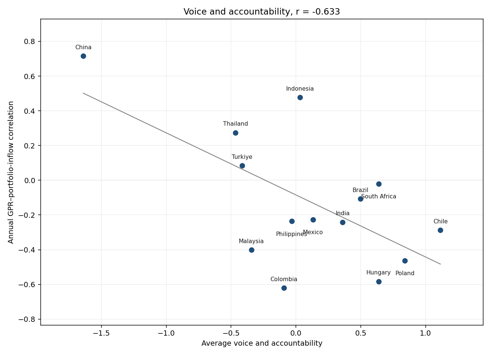
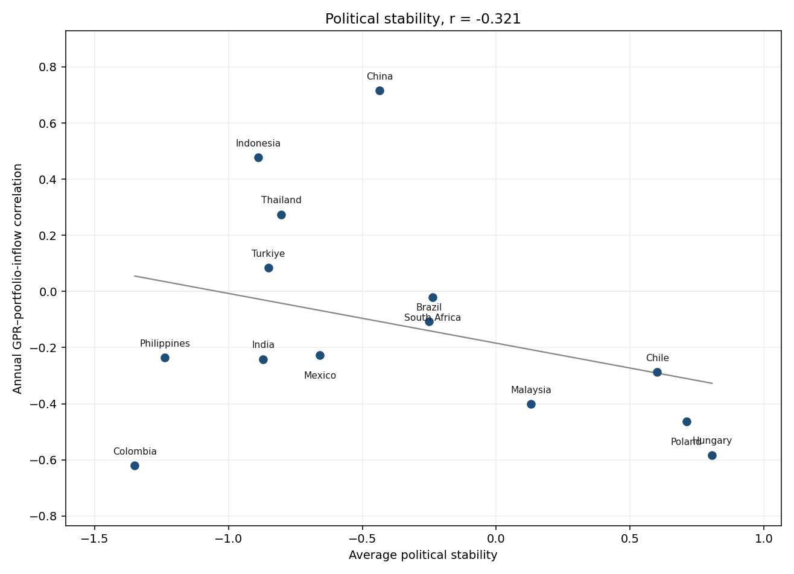
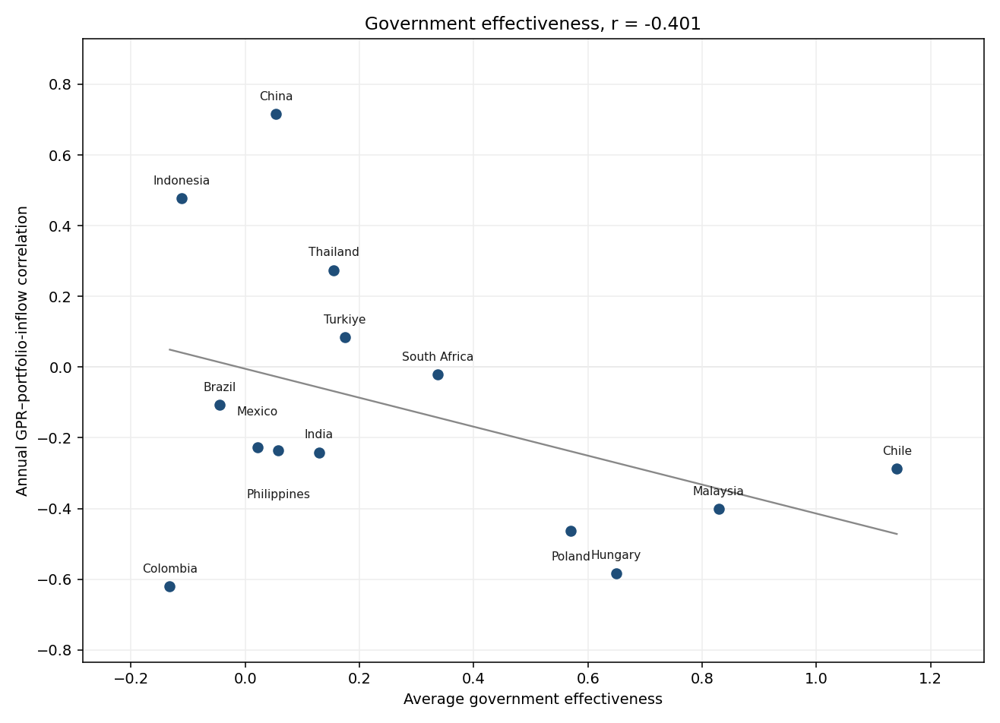
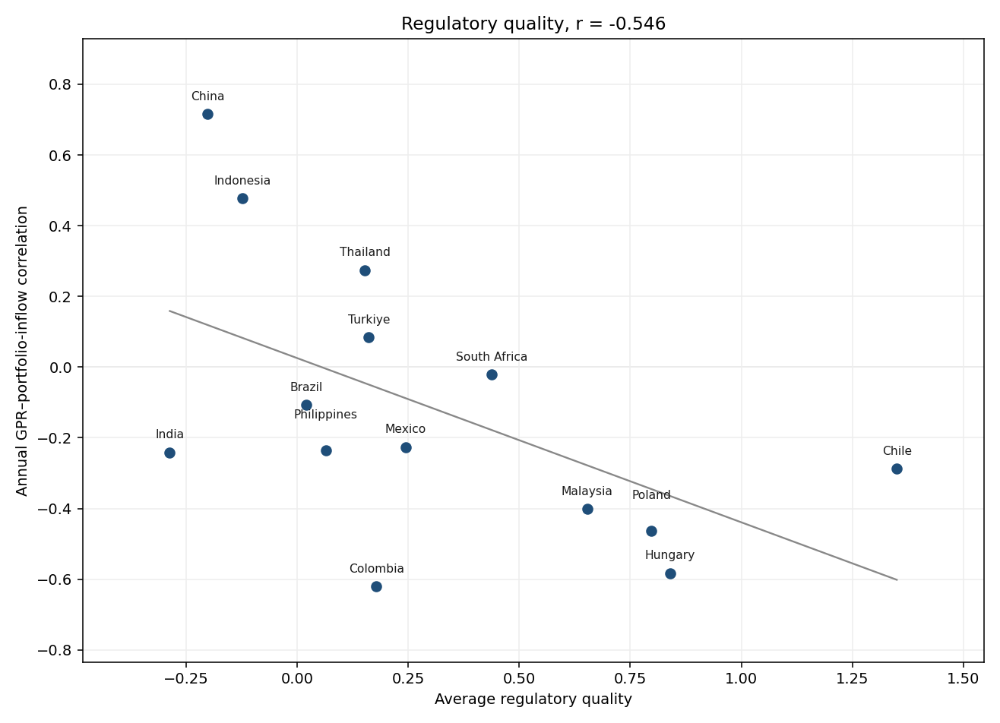
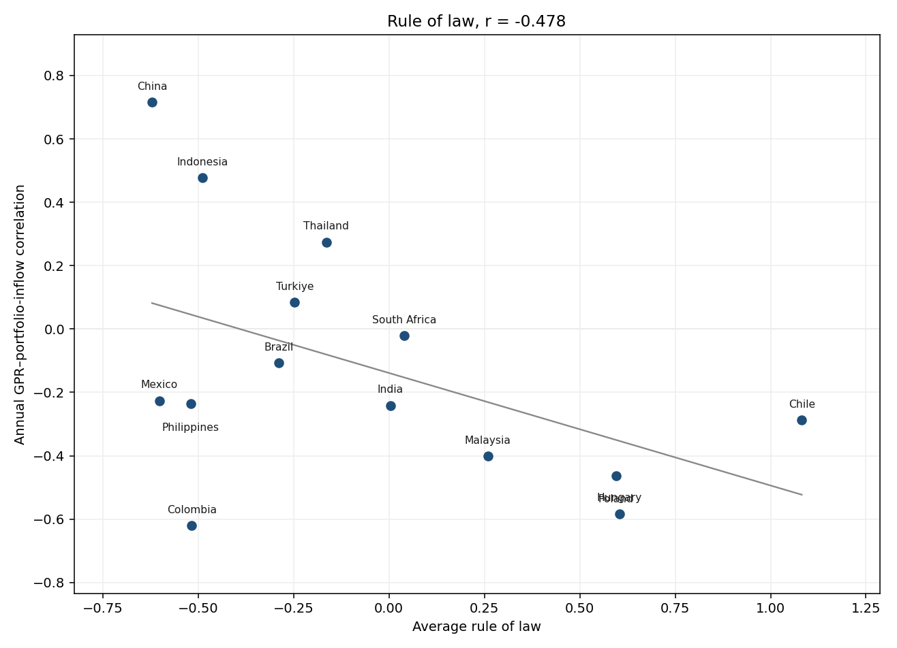
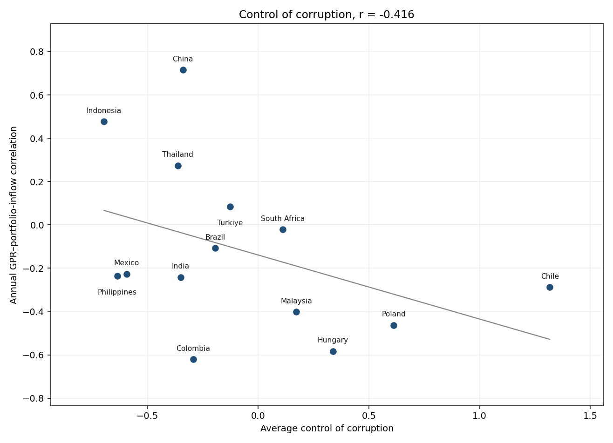

## `portfolio_inflow`

`portfolio_inflow` is the monthly gross portfolio inflow: how many billion US dollars foreign investors put into that country’s stocks and bonds that month.

It is the OECD Monthly Capital Flow Dataset column `port_inf` (de Crescenzio and Lepers), copied unchanged into `cleaned/replication_cleaned/country_month.csv`. The codebook unit is billion US dollars. Where country names match, the cleaned value equals the raw value in `econ4999b_literature_review/replication/raw/oecd_capital_flows.xlsx`, sheet `panel`.

A positive number means foreign investors were net buyers of the country’s portfolio securities that month. A negative number means they were net sellers. About two-fifths of the non-missing months in the raw file are negative, so this is a signed flow. In the OECD file, “gross” means the foreign-investor side only. Residents’ purchases of foreign securities are the separate column `port_out`. For almost every country-month, `port_inf` equals portfolio equity inflows (`eq_inf`) plus portfolio debt inflows (`debt_inf`). Foreign direct investment and bank/other investment are separate columns and are not in this series.

The annual outcome below is the average of the twelve monthly values in year \(t\), and a year is kept only when all twelve months exist. A regression coefficient is therefore in billion US dollars of that year’s average monthly inflow. The same monthly series is what the Beirne–Renzhi paper turns into capital-flow volatility (the standard deviation over the current and previous two months). This note uses the level of the flow.

Coverage is not the same concept in every emerging economy. The OECD notes say:

| Country | What `port_inf` covers |
| --- | --- |
| Brazil, Chile, Hungary, Philippines, Poland, Türkiye | Full balance-of-payments portfolio inflows (equity and debt) |
| Colombia, South Africa | Portfolio inflows |
| China | Portfolio inflows; debt is renminbi securities only, and equity is valuation-adjusted with the Shanghai composite |
| India | Portfolio inflows from the Reserve Bank of India. The equity/debt split in the same file does not always add up to `port_inf` (largest gap about $25 billion) |
| Indonesia | Portfolio inflows; many months are debt only, and debt is rupiah government securities |
| Malaysia | Mostly portfolio debt inflows (176 of 186 months have no equity figure) |
| Mexico | Portfolio inflows; debt is government securities only |
| Thailand | Equity and debt throughout; from August 2020 the debt part is government, Bank of Thailand, and state-owned-enterprise securities |

Time series for each emerging economy: [emerging_portfolio_inflow.html](../output/emerging_portfolio_inflow.html). The series is `portfolio_inflow` in `cleaned/replication_cleaned/country_month.csv`.

## Formula and data

This is the annual emerging regression in `model1.md` ("Annual estimates, emerging economies"). The right-hand side, country fixed effects, and country-clustered standard errors stay. The outcome is that year's mean. It replaces the change in mean log REER. The regression is `output/run_model1_annual_capital_flow.py`. It reproduces the published voice-and-accountability REER column before the outcome is replaced.

\[
\bar y_{it}
= \alpha_i
+ \beta_1 \overline{GPR}^{z}_{it}
+ \beta_2 WGI_{it}
+ \beta_3 \bigl(WGI_{it} \times \overline{GPR}^{z}_{it}\bigr)
+ \boldsymbol{\gamma}^{\mathsf T}\mathbf{X}_{it}
+ \varepsilon_{it}
\]

\(i\) is the country and \(t\) is the calendar year. \(\bar y_{it}\) is the mean of the outcome in year \(t\). \(\alpha_i\) is a country fixed effect. One regression uses one WGI score. The six scores are voice and accountability, political stability, government effectiveness, regulatory quality, rule of law, and control of corruption. The six scores are blank in the same months, so the six regressions use the same country-years. The interaction is that year's WGI score times that year's mean `gpr_z`. The product is not centered.

\(\overline{GPR}^{z}_{it}\) is the mean of the twelve monthly `gpr_z` values. Log VIX is the mean of the twelve monthly logs of `vix`. Each other control is the twelve-month mean in year \(t\) minus the twelve-month mean in year \(t-1\). Financial development and debt/GDP are annual levels repeated within the year, so their means are those annual levels. A control year stays in only when year \(t\) and year \(t-1\) are consecutive and every required control month is observed. The outcome needs only its own observations in year \(t\). The window is 2002–2021. Standard errors are clustered by country, with the sandwich factor and \(t_{G-1}\) \(p\)-values in `model1.md`.

| Role | Column | File | Timing |
| --- | --- | --- | --- |
| GPR, standardized | `gpr_z` | `cleaned/replication_cleaned/country_month.csv` | Mean of the twelve months in year \(t\) |
| WGI | `wgi_va`, `wgi_pv`, `wgi_ge`, `wgi_rq`, `wgi_rl`, or `wgi_cc` | same file | That year's score |
| WGI × GPR | WGI × mean `gpr_z` | same file | Both from year \(t\) |
| Policy rate | `policy_rate` | same file | Change in the twelve-month mean |
| Inflation | `inflation` | same file | Change in the twelve-month mean |
| Log oil price | `oil_price` | same file | Change in the twelve-month mean of the monthly log |
| Log VIX | `vix` | same file | Mean of the twelve monthly logs, year \(t\) |
| Log global EPU | `gepu` | same file | Change in the twelve-month mean of the monthly log |
| Financial development | `financial_development` | same file | This year's level minus last year's level |
| Debt/GDP | `public_debt_gdp` | same file | This year's level minus last year's level |

The right-hand side is complete for 273 country-years and 14 emerging economies: Brazil, Chile, China, Colombia, Hungary, India, Indonesia, Malaysia, Mexico, Philippines, Poland, South Africa, Thailand, and Turkiye. Indonesia is 2007–2021 and Turkiye is 2004–2021. Ukraine has no policy rate, so it stays out.

## Portfolio inflow

\[
\bar y_{it}=\overline{\text{portfolio inflow}}_{it}
\]

The outcome is the mean of the twelve monthly `portfolio_inflow` values in year \(t\), in billion US dollars. The column is in `cleaned/replication_cleaned/country_month.csv`. A year stays in when all twelve months of that year are observed.

Joined to the complete right-hand side, this is 212 country-years and the same 14 economies. The shorter spans are Chile 2003–2021, China 2014–2021, Colombia 2015–2021, Hungary 2008–2021, Indonesia 2011–2021, Malaysia 2012–2021, Mexico 2009–2021, Philippines 2005–2021, Poland 2004–2021, and Thailand 2005–2021. Brazil, India, and South Africa are 2002–2021. Turkiye remains 2004–2021.

212 country-years, 14 emerging economies, 2002–2021. Parentheses are country-clustered standard errors. \(p<0.01\), \(p<0.05\), \(p<0.10\). A coefficient is in billion US dollars of that year's mean monthly inflow. Results are `output/model1_annual_emerging_portfolio_inflow_results.csv`.

|  | Voice and accountability | Political stability | Government effectiveness | Regulatory quality | Rule of law | Control of corruption |
| --- | ---: | ---: | ---: | ---: | ---: | ---: |
| WGI | 0.934876 (0.874832) | 1.226822 (0.855889) | 1.923105 (1.118081) | 1.725260 (1.030246) | 2.598045* (1.411635) | 2.539607* (1.392159) |
| GPR, standardized | 0.619373 (0.523082) | 0.397482 (0.854314) | 0.133355 (0.454592) | 0.694941 (1.022871) | 0.462183 (0.691834) | 0.432294 (0.719731) |
| WGI × GPR | −2.427059* (1.269293) | −0.151867 (0.376015) | 0.690866 (1.109308) | −0.916175 (0.980759) | −1.174755 (1.008202) | 0.063206 (0.430781) |
| Policy rate, annual change | 0.053779 (0.048560) | 0.067564 (0.050326) | 0.062216 (0.057768) | 0.035734 (0.051976) | 0.075647* (0.041155) | 0.063800 (0.054694) |
| Inflation, annual change | −0.027537 (0.053114) | −0.047751 (0.048355) | −0.055844 (0.056936) | −0.032972 (0.047583) | −0.021311 (0.039785) | −0.050058 (0.052639) |
| Log oil price, annual change | 0.059050 (0.326338) | 0.197407 (0.441967) | 0.415696 (0.522862) | 0.144308 (0.398613) | 0.053016 (0.355709) | 0.199574 (0.447870) |
| Log VIX | 0.889952 (0.854225) | 0.517403 (0.580455) | 0.685866 (0.673051) | 0.424776 (0.659471) | 0.623299 (0.733402) | 0.286102 (0.557598) |
| Log global EPU, annual change | −1.291865** (0.547734) | −0.881117** (0.356134) | −0.887719* (0.417993) | −0.986116** (0.411313) | −1.414808** (0.611422) | −0.959567** (0.364814) |
| Financial development, annual change | 4.544375 (5.757638) | −0.544923 (4.108520) | 0.965310 (5.759646) | −0.022468 (3.812684) | 1.084183 (4.031983) | 0.763774 (4.855253) |
| Debt/GDP, annual change | −0.032081 (0.029057) | −0.002861 (0.047739) | −0.006713 (0.045339) | −0.002528 (0.036668) | 0.014201 (0.048315) | 0.008666 (0.046336) |
| Observations | 212 | 212 | 212 | 212 | 212 | 212 |
| Countries | 14 | 14 | 14 | 14 | 14 | 14 |
| Years | 2002 to 2021 | 2002 to 2021 | 2002 to 2021 | 2002 to 2021 | 2002 to 2021 | 2002 to 2021 |
| Within \(R^2\) | 0.2437 | 0.0545 | 0.0655 | 0.0708 | 0.1032 | 0.0768 |
| \(R^2\) | 0.6558 | 0.5696 | 0.5746 | 0.5771 | 0.5918 | 0.5798 |

### Correlation of annual GPR and annual portfolio inflow

Pearson correlation of annual `gpr_z` (x) and annual portfolio inflow (y), computed separately for each country.

For each calendar year, x is the average of the twelve monthly `gpr_z` values. y is the average of the twelve monthly `portfolio_inflow` values. Both columns are in `cleaned/replication_cleaned/country_month.csv`.

A year is kept only when both series are observed in all twelve months. The window is 2002 through 2021. The Years column is the number of those years. Brazil, India, South Africa, and Turkiye use all 20 years. The shorter spans are Chile 2003–2021, China 2014–2021, Colombia 2015–2021, Hungary 2008–2021, Indonesia 2011–2021, Malaysia 2012–2021, Mexico 2009–2021, Philippines 2005–2021, Poland 2004–2021, and Thailand 2005–2021.

A positive correlation means years with a higher average GPR line up with a higher average monthly portfolio inflow.

| Country | Correlation | Years |
| --- | ---: | ---: |
| Brazil | −0.107 | 20 |
| Chile | −0.287 | 19 |
| China | 0.716 | 8 |
| Colombia | −0.620 | 7 |
| Hungary | −0.583 | 14 |
| India | −0.242 | 20 |
| Indonesia | 0.477 | 11 |
| Malaysia | −0.401 | 10 |
| Mexico | −0.226 | 13 |
| Philippines | −0.236 | 17 |
| Poland | −0.462 | 18 |
| South Africa | −0.021 | 20 |
| Thailand | 0.274 | 17 |
| Turkiye | 0.084 | 20 |

### Correlation between the annual GPR–portfolio-inflow correlation and average WGI

Across the 14 emerging economies. Pearson correlation between the country's annual correlation and that country's average WGI score.

The annual correlation is the country figure in the table above. The WGI average is the mean of the available annual values from January 2000 through December 2023. WGI is blank in 2001, so each average uses 2000 and 2002 through 2023 (23 years).

A positive correlation means economies with a higher average WGI tend to have a higher annual correlation between standardized GPR and portfolio inflow.

| WGI measure | Correlation |
| --- | ---: |
| Voice and accountability | −0.633 |
| Political stability | −0.321 |
| Government effectiveness | −0.401 |
| Regulatory quality | −0.546 |
| Rule of law | −0.478 |
| Control of corruption | −0.416 |

Charts: [correlation_annual_gpr_portfolio_inflow_and_wgi_emerging.html](../output/correlation_annual_gpr_portfolio_inflow_and_wgi_emerging.html)

## What the scatter plots imply

Each point is one emerging economy. The horizontal axis is that country's average WGI score over 2000 and 2002–2023. The vertical axis is the country's correlation, from the table above, between annual standardized GPR and annual portfolio inflow. The line slopes down in every chart. The slope is steepest for voice and accountability (\(r = -0.633\)) and regulatory quality (\(r = -0.546\)), and flattest for political stability (\(r = -0.321\)).

A country high on the vertical axis, such as China (0.716, 8 years) or Indonesia (0.477, 11 years), has higher portfolio inflows in years when its own GPR is higher. A country low on the vertical axis, such as Hungary (−0.583), Colombia (−0.620, 7 years), or Poland (−0.462), has weaker inflows in those years. Because the lines slope down, the high points sit toward weaker average governance and the low points sit toward stronger average governance. Chile, Poland, and Hungary, with higher voice and accountability, lie below zero. China, Indonesia, and Thailand lie above zero and further left.

Read as a description of these 14 points, a rise in country GPR lines up with weaker portfolio inflows in the better-governed economies and with stronger portfolio inflows in several lower-WGI economies. The charts do not show that governance itself changes that response. The horizontal axis is a long-run average, so the comparison is between countries that have had different governance scores, not a country whose governance changed and then responded differently to GPR. China and Colombia are the extreme vertical points and rest on 8 and 7 years, so they pull the slope. The unit is a correlation, so the charts do not give a billion-dollar response to a one-standard-deviation rise in GPR.

## Why the regression does not establish that result

The annual regression was the test of whether governance changes the inflow response to country GPR, after country fixed effects and the macro controls. It does not establish that.

Country GPR is insignificant in all six columns. The point estimates are positive and small relative to their country-clustered standard errors, from 0.133 (0.455) for government effectiveness to 0.695 (1.023) for regulatory quality. The interaction of WGI with GPR, which is the term for a different GPR slope at a different WGI score, is significant only for voice and accountability, at the 10 percent level: −2.427 (1.269). Because that product is not centered, the voice-and-accountability slope on GPR at a given score is about \(0.619 - 2.427 \times \text{WGI}\). That point estimate has the same sign as the voice-and-accountability chart, and its standard error is large. The other five interactions are insignificant. Government effectiveness (0.691) and control of corruption (0.063) have the opposite sign from the charts.

Two WGI level coefficients reach the 10 percent level, rule of law (2.598) and control of corruption (2.540). Those associate a higher score with a higher average monthly inflow. They are not the response in a high-GPR year. With 14 clusters, the standard errors on GPR are about 0.5 to 1.0 billion dollars per within-country standard deviation, so an effect large enough to matter can still sit inside the confidence interval. An insignificant coefficient here means the sample does not separate the effect from zero.

The fit also shows where the regression is thin. Overall \(R^2\) is 0.57 to 0.66, while within \(R^2\) is 0.24 for voice and accountability and 0.05 to 0.10 for the other five scores. Country fixed effects account for the persistent differences in average inflows. The controls explain little of the year-to-year movement. The coefficient that is signed the same way in every column, and significant in every column, is the annual change in log global economic-policy uncertainty, from −0.881 to −1.415. In this specification, portfolio inflows move with that global push factor. They do not move precisely with country GPR, and governance does not precisely change the country-GPR slope.

Across these 14 economies, better average governance, especially voice and accountability, coincides with a more negative raw correlation between annual GPR and annual portfolio inflow. The regression does not show that better governance changes the inflow response when country GPR rises.