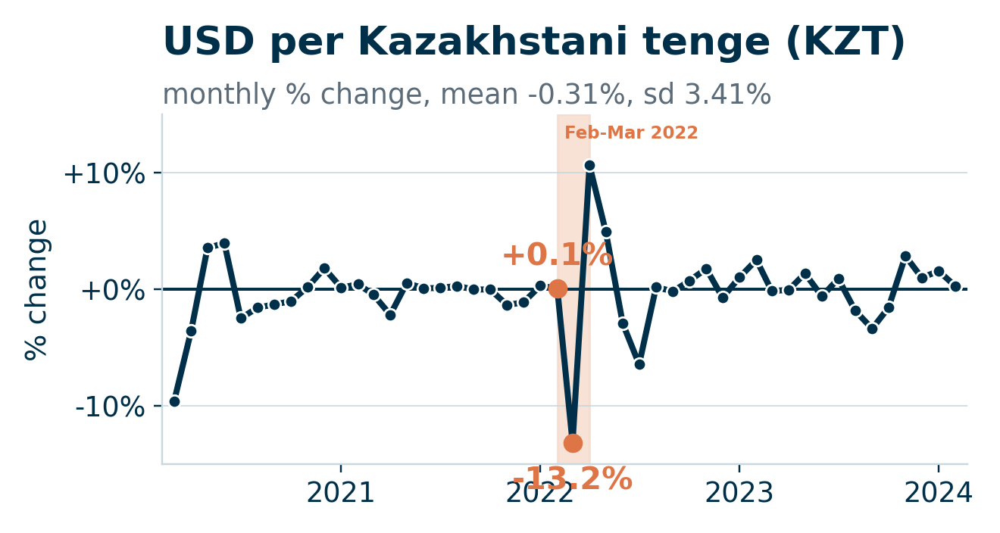
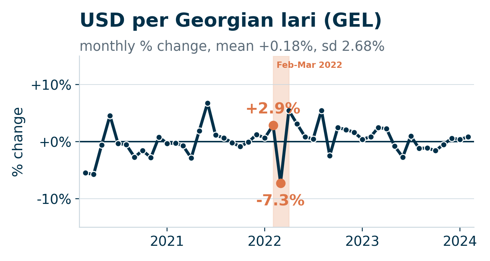

---
format:
  revealjs:
    css: master_presentation.css
    width: 1280
    height: 720
    margin: 0.06
    slide-number: true
    transition: none
    embed-resources: true
---

## Geopolitical risk, WGI, and the real exchange rate {.cover}

::: {.cover-content}
ECON 4999B

# Geopolitical risk, WGI, and the real exchange rate

**Capital-flow volatility and the export channel**

Research presentation  
November 2026
:::

## Definition of Geopolitical Risk, Institutional Quality and Exchange Rate

::: {.question-banner}
**Does WGI change how geopolitical risk moves the real exchange rate, and does that run through capital-flow volatility or exports?**
:::

- **Geopolitical Risk**: armed conflict, terrorism, and tension between states — not general economic uncertainty
  - we will measure Geopolitical Risk with the paper uses the monthly country-specific GPR index of Caldara and Iacoviello (2022)
- **Institutional Quality**: The quality of an institution
  - we use the world governance index as a proxy of institutional quality
- **Exchange rate**: real effective exchange rate
  - we would like to capture the price movement between domestic and its trade partner

## Content

- **Motivation**
- **Transmission Channel**
  - Channel 1: How IQ affect real effective exchange rate and via the channel of export
  - Channel 2: How does IQ affect the stability of real effective exchange rate via volatility of capital flow
- **Result Overview**
- **Channel result**
- **Robustness test - Subsample**
- **Conclusion**

## Motivation - Russia-Ukraine War

::: {.columns}
::: {.column width="50%"}
::: {.chart-card}
::: {.card-label}
Kazakhstan
:::

:::
:::

::: {.column width="50%"}
::: {.chart-card}
::: {.card-label}
Georgia
:::

:::
:::
:::

- With similar exposure to the crisis, Georgia displays a smaller decline in exchange rate
- We know that Kazakhstan has a more significant corruption issue than Georgia

::: {.question-banner}
**Can institutional quality explain the difference in the decline in exchange rate?**
:::

## Channel 1: How Institutional Quality affect Exchange Rate

- **Model 1: How institutional quality affect exchange rate directly**
  - Real effective exchange rate directly regress on Institutional Quality, Geopolitical Risk and its interaction
- **Model 2: How institutional quality affect exchange rate via nominal export**
  - First regress nominal export on institutional quality, geopolitical risk and its interaction
  - Then, regress real effective exchange rate on the estimated nominal export
- **Model 3: How institutional quality affect exchange rate via real export**
  - First regress real export on institutional quality, geopolitical risk and its interaction
  - Then, regress real effective exchange rate on the estimated real export

## Channel 2: How Institutional Quality affect Capital Flow Volatility

- **Intuition: weaker institution should experience a more volatile currency**
  - We would like to rule out the possibility of managed flow such as Vietnam, therefore we will measure the vol. in capital flow instead
- **Model: extend on John Beirne model, we will include institutional quality in his model measuring how geopolitical risk affecting capital flow vol**

## Subsample design {#subsample-design-overview}

::: {.title-eq}
$$
y_{i,t}^{j}=\beta_1 GPR_{i,t}^{z}+\beta_2 WGI_{i,t-1}+\gamma'X_{i,t-1}+\delta_i+\varepsilon_{i,t}
$$
:::

::: {.eq-note}
$y^{j}$: capital-flow volatility or log real exchange rate
:::

::: {.columns}
::: {.column width="50%"}
::: {.finding-card}
**Top and bottom groups**

- **Sample**: 10 emerging economies with complete months
- **Split**: top three and bottom three on each WGI aspect, 2000–2021 average
- **Left out before ranking**: Indonesia, the Philippines, South Africa, Thailand, Ukraine
:::
:::

::: {.column width="50%"}
::: {.finding-card}
**What is estimated**

- **GPR**: standardized within country on the months in that regression
- **WGI**: lagged score, not centered, so GPR is the effect at a score of zero
:::
:::
:::

## Net-export channel

::: {.columns}
::: {.column width="50%"}
::: {.finding-card}
::: {.card-label}
Model 2 first stage
:::

**WGI and the nominal-export trend**

- Rule of law on the log export trend is −2.03***
- GPR and WGI × GPR are insignificant
- Fitted export then enters the real-rate equation
:::
:::

::: {.column width="50%"}
::: {.finding-card}
::: {.card-label}
Models 2 and 3
:::

**Export to the real exchange rate**

- Fitted nominal-export trend, rule of law: −0.155***
- A higher fitted export trend depreciates log REER
- Model 3 puts GPR, WGI, and the interaction only in the inflation and real-export first stages
:::
:::
:::

## Inflation results

::: {.columns}
::: {.column width="40%"}
::: {.finding-card}
::: {.card-label}
Model 3, first stage
:::

**WGI, not GPR, lines up with inflation**

- Political stability WGI −3.22**; government effectiveness −4.08*
- GPR and WGI × GPR are insignificant
- Five countries, 2006–01 to 2022–01
:::
:::

::: {.column width="60%"}
::: {.table-area}
**Inflation, Model 3**

| Variable | Political stability | Government effectiveness |
|:-----------|:---------:|:---------:|
| GPR | −0.062 | −0.029 |
| WGI × GPR | 0.130 | −0.025 |
| Controls | Yes | Yes |
| Observations | 956 | 956 |

::: {.table-note}
Clustered standard errors by country. GPR, WGI, and the interaction are in this stage only. *** p&lt;0.01, ** p&lt;0.05, * p&lt;0.10.
:::
:::
:::
:::

## Real-export results

::: {.columns}
::: {.column width="40%"}
::: {.finding-card}
::: {.card-label}
Model 3, first stage
:::

**WGI is negative on the real-export trend**

- Rule of law −1.009***; control of corruption −1.004**
- GPR and WGI × GPR are about zero
- Within-country scores fell while export trends rose; not a causal cut in trade
:::
:::

::: {.column width="60%"}
::: {.table-area}
**Real-export log trend, Model 3**

| Variable | Rule of law | Control of corruption |
|:-----------|:---------:|:---------:|
| GPR | 0.000 | 0.008 |
| WGI × GPR | −0.004 | −0.001 |
| Controls | Yes | Yes |
| Observations | 956 | 956 |

::: {.table-note}
Clustered standard errors by country. Chile, Hungary, India, Mexico, and Turkey. *** p&lt;0.01, ** p&lt;0.05, * p&lt;0.10.
:::
:::
:::
:::

## Interpreting the results

::: {.stacked-point}
::: {.point-label}
Model 1
:::
**No GPR effect at average WGI**: GPR on log REER is about zero. WGI is positive. WGI × GPR is not a buffer in the full 27-country sample.
:::

::: {.stacked-point}
::: {.point-label}
Capital-flow volatility
:::
**Pooled GPR is negative, clustered insignificant**: the United States pulls the 24-country slope down. Among emerging markets the simple slope is about +0.06 and the country signs are mixed.
:::

::: {.stacked-point}
::: {.point-label}
Export channel
:::
**WGI, not GPR, lines up with exports**: rule of law on the real-export trend is −1.009***. GPR and the interaction stay near zero. That coefficient is the within-country decline in scores while export trends rose.
:::

## Subsample design

::: {.title-eq}
$$
\begin{aligned}
&y_{i,t}^{j}=\beta_1 GPR_{i,t}^{z}+\beta_2 WGI_{i,t-1}+\beta_3(WGI_{i,t-1}\times GPR_{i,t}^{z})\\
&+\gamma'X_{i,t-1}+\delta_i+\varepsilon_{i,t}
\end{aligned}
$$

$y^{j}$: capital-flow volatility or log real exchange rate
:::

::: {.columns}
::: {.column width="50%"}
::: {.finding-card}
**Top and bottom groups**

- **Sample**: 10 emerging economies with complete months
- **Split**: top three and bottom three on each WGI aspect, 2000–2021 average
- **Left out before ranking**: Indonesia, the Philippines, South Africa, Thailand, Ukraine
:::
:::

::: {.column width="50%"}
::: {.finding-card}
**What is estimated**

- **GPR**: standardized within country on the months in that regression
- **WGI**: lagged score, not centered, so GPR is the effect at a score of zero
- **WGI × GPR**: change in the GPR association for a one-point higher score
:::
:::
:::

::: {.bottom-callout}
**Two completed checks**: rank all ten; then remove China, rank the remaining nine again, and re-estimate the top three and bottom three. Country fixed effects. Controls are lagged one month.
:::

## How to read WGI × GPR

::: {.columns}
::: {.column width="50%"}
::: {.finding-card}
::: {.card-label}
Exchange rate
:::

**Log real effective exchange rate**

- **Negative**: a higher score, a weaker currency when GPR is higher
- **Positive**: a higher score, a stronger currency when GPR is higher
- About a 1 percent move for a coefficient of 0.01
:::
:::

::: {.column width="50%"}
::: {.finding-card}
::: {.card-label}
Capital-flow volatility
:::

**Three-month standard deviation of portfolio inflows**

- **Negative**: a higher score, calmer inflows when GPR is higher
- **Positive**: a higher score, more volatile inflows when GPR is higher
- The unit is billion dollars
:::
:::
:::

::: {.bottom-callout}
**Stars**: within standard errors. *** p&lt;0.01, ** p&lt;0.05, * p&lt;0.10. Each group is three countries.
:::

## All ten: WGI × GPR

::: {.table-area .wide-table}
**Top three and bottom three of the ten emerging economies**

| Aspect | Capital-flow Volatility, top | Capital-flow Volatility, bottom | Exchange Rate, top | Exchange Rate, bottom |
|:-------|:--------:|:-----------:|:------:|:---------:|
| Voice and accountability | 0.129 | −0.321 | −0.002 | −0.014** |
| Political stability | 0.272 | −0.105 | 0.006 | −0.021*** |
| Government effectiveness | −0.102 | 0.194 | −0.013 | −0.022* |
| Regulatory quality | 0.042 | 1.137 | −0.011** | −0.017 |
| Rule of law | 0.133 | 1.018 | −0.005 | 0.030* |
| Control of corruption | −0.032 | −0.067 | 0.004 | 0.021** |

::: {.table-note}
Every WGI × GPR cell from the ten-economy top-and-bottom results. Within standard errors. No volatility interaction is significant. Exchange Rate is the log real effective exchange rate.
:::
:::

## China removed: WGI × GPR

::: {.table-area .wide-table}
**China is removed, then the remaining nine are ranked again**

| Aspect | Capital-flow Volatility, top | Capital-flow Volatility, bottom | Exchange Rate, top | Exchange Rate, bottom |
|:-------|:--------:|:-----------:|:------:|:---------:|
| Voice and accountability | 0.129 | 0.156 | −0.002 | −0.021** |
| Political stability | 0.272 | −0.105 | 0.006 | −0.021*** |
| Government effectiveness | −0.102 | −1.545*** | −0.013 | −0.043*** |
| Regulatory quality | 0.042 | 0.406 | −0.011** | −0.019* |
| Rule of law | 0.133 | 0.236 | −0.005 | 0.031** |
| Control of corruption | −0.032 | −0.224 | 0.004 | 0.039*** |

::: {.table-note}
Top three are unchanged. New bottom three: voice and accountability, Malaysia, Türkiye, Colombia; government effectiveness, Colombia, Brazil, Mexico; regulatory quality, India, Brazil, Colombia; rule of law, Mexico, Colombia, Brazil; control of corruption, Mexico, India, Colombia. Political stability is unchanged.
:::
:::

## What stays the same

::: {.stacked-point}
::: {.point-label}
Exchange rate, low-score groups
:::
**Mostly not a buffer**: voice and accountability, political stability, and government effectiveness stay negative in the bottom three. A higher score goes with a weaker real exchange rate when GPR is higher.
:::

::: {.stacked-point}
::: {.point-label}
Two positive exceptions
:::
**Rule of law and control of corruption**: the bottom-three exchange-rate interactions stay positive after China is removed, 0.031 and 0.039, both significant at the 5 percent level or better. A higher score goes with a stronger real exchange rate when GPR is higher.
:::

::: {.stacked-point}
::: {.point-label}
What changes
:::
**Government effectiveness**: the bottom three become Colombia, Brazil, and Mexico. The exchange-rate interaction is −0.043 and the volatility interaction is −1.545, both significant at the 1 percent level. Regulatory quality in the new bottom three is −0.019, significant at the 10 percent level.
:::

## Conclusion

::: {.stacked-point}
::: {.point-label}
Buffering
:::
**Model 1**: GPR does not move log REER at average WGI. WGI itself is positive. The interaction is not a full-sample buffer.
:::

::: {.stacked-point}
::: {.point-label}
Mechanisms
:::
**Two channels**: pooled volatility GPR is negative but clustered insignificant; emerging signs mix. On exports, WGI is negative and GPR is not.
:::

::: {.stacked-point}
::: {.point-label}
Robustness
:::
**Limits**: Model 3 has five countries. Use clustered standard errors. The OECD portfolio series does not match the paper’s Table 1 vintage.
:::

## Questions {.closing}

::: {.closing-content}
**Questions**
:::
